# COMP3353 Bioinformatics — Assignment 3: HMMs, MSA, omics data analysis

**Name:** Zheng Choi I  
**University Number:** 3035987788  
**Email:** u3598778@connect.hku.hk

I answered all three questions. Each question has one Python 3 script in
`src/`, and the full code is pasted under each question. All numbers,
alignments and figures below come from running these scripts on the provided
`data/` folder (raw outputs are in `results/`).

```bash
pip install -r requirements.txt
python src/q1_hmm.py        # Q1  -> results/q1_*
python src/q2_msa.py        # Q2  -> results/q2*
python src/q3_spatial.py    # Q3  -> results/q3*
```

---

## Question 1: Hidden Markov Model, Viterbi decoding, Posterior decoding

### Source code (`src/q1_hmm.py`)

The parameters are the ones in the handout: `P(M)=0.1, P(S)=0.9`, transitions
`0.95/0.05`, and each group's emission probability shared equally by its amino
acids (8 hydrophobic, 12 polar), e.g. `e_M(G) = 0.85/8` and `e_S(R) = 0.70/12`.
All recursions are done with natural logs: products become sums, and the sums
in Forward/Backward use `scipy.special.logsumexp`. This is needed because P(x)
for bacteriorhodopsin is about 10^-335, which is 0 in double precision.

```python
"""COMP3353 A3 Q1: two-state transmembrane HMM.

Implements (a) Viterbi decoding, (b) Forward, (c) Backward and
(d) Posterior decoding.  All computations are done in log space so the
probabilities do not underflow for long sequences.

Usage:  python q1_hmm.py data/Q1/P02724.fasta [data/Q1/P02945.fasta ...]
"""
import os
import sys

import numpy as np
from scipy.special import logsumexp
import matplotlib

matplotlib.use("Agg")
import matplotlib.pyplot as plt

STATES = ["M", "S"]                      # index 0 = M (membrane), 1 = S (soluble)
HYDROPHOBIC = set("GAVILMFW")             # group H
POLAR = set("RNDCEQHKPSTY")               # group P

# Model parameters
INIT = np.array([0.1, 0.9])              # P(M), P(S)
TRANS = np.array([[0.95, 0.05],          # a[k' -> k], rows = from, cols = to
                  [0.05, 0.95]])
# Group-level emission probabilities; each amino acid in a group gets an
# equal share (8 hydrophobic, 12 polar amino acids).
GROUP_EMIT = {"M": {"H": 0.85, "P": 0.15}, "S": {"H": 0.30, "P": 0.70}}


def emission_prob(state, aa):
    if aa in HYDROPHOBIC:
        return GROUP_EMIT[state]["H"] / len(HYDROPHOBIC)
    if aa in POLAR:
        return GROUP_EMIT[state]["P"] / len(POLAR)
    raise ValueError(f"unknown amino acid {aa!r}")


def read_single_fasta(path):
    header, seq = None, []
    with open(path) as f:
        for line in f:
            line = line.strip()
            if not line:
                continue
            if line.startswith(">"):
                header = line[1:]
            else:
                seq.append(line)
    return header, "".join(seq).upper()


def log_emissions(seq):
    """L x K matrix of log e_k(x_t)."""
    return np.log(np.array([[emission_prob(s, aa) for s in STATES] for aa in seq]))


LOG_INIT = np.log(INIT)
LOG_TRANS = np.log(TRANS)


# ---------------------------------------------------------------- (a) Viterbi
def viterbi(seq):
    E = log_emissions(seq)
    L, K = E.shape
    V = np.zeros((L, K))
    ptr = np.zeros((L, K), dtype=int)
    V[0] = E[0] + LOG_INIT                          # V_k(1) = e_k(x1) P(k)
    for t in range(1, L):
        # cand[k', k] = V_k'(t-1) + log a_{k'->k}
        cand = V[t - 1][:, None] + LOG_TRANS
        ptr[t] = cand.argmax(axis=0)
        V[t] = E[t] + cand.max(axis=0)
    # traceback
    path = np.zeros(L, dtype=int)
    path[-1] = V[-1].argmax()
    for t in range(L - 1, 0, -1):
        path[t - 1] = ptr[t, path[t]]
    return "".join(STATES[k] for k in path), V[-1].max()


# ---------------------------------------------------------------- (b) Forward
def forward(seq):
    E = log_emissions(seq)
    L, K = E.shape
    F = np.zeros((L, K))
    F[0] = E[0] + LOG_INIT
    for t in range(1, L):
        F[t] = E[t] + logsumexp(F[t - 1][:, None] + LOG_TRANS, axis=0)
    return F, logsumexp(F[-1])                      # log P(x) = log sum_k F_k(L)


# --------------------------------------------------------------- (c) Backward
def backward(seq):
    E = log_emissions(seq)
    L, K = E.shape
    B = np.zeros((L, K))                            # B_k(L) = 1  -> log 0
    for t in range(L - 2, -1, -1):
        # B_k(t) = sum_k' a_{k->k'} e_k'(x_{t+1}) B_k'(t+1)
        B[t] = logsumexp(LOG_TRANS + (E[t + 1] + B[t + 1])[None, :], axis=1)
    logp = logsumexp(LOG_INIT + E[0] + B[0])        # sum_k P(k) e_k(x1) B_k(1)
    return B, logp


# ------------------------------------------------------ (d) Posterior decoding
def posterior(seq):
    F, logp_f = forward(seq)
    B, _ = backward(seq)
    log_post = F + B - logsumexp(F + B, axis=1, keepdims=True)
    post = np.exp(log_post)
    path = "".join(STATES[k] for k in post.argmax(axis=1))
    return path, post


# ------------------------------------------------------------------ helpers
def segments(path, state="M"):
    """1-based inclusive (start, end) runs of `state`."""
    out, start = [], None
    for i, s in enumerate(path, 1):
        if s == state and start is None:
            start = i
        if s != state and start is not None:
            out.append((start, i - 1))
            start = None
    if start is not None:
        out.append((start, len(path)))
    return out


def sci(logp):
    """Format exp(logp) in scientific notation without underflow."""
    l10 = logp / np.log(10)
    e = int(np.floor(l10))
    return f"{10 ** (l10 - e):.6f}e{e}"


def wrap(s, n=60):
    return "\n".join(s[i:i + n] for i in range(0, len(s), n))


def plot(name, seq, vit, post_path, post, out_png):
    x = np.arange(1, len(seq) + 1)
    fig, axes = plt.subplots(2, 1, figsize=(12, 5), sharex=True)
    ax = axes[0]
    ax.step(x, [1 if s == "M" else 0 for s in vit], where="mid",
            label="Viterbi", color="C0", lw=2)
    ax.step(x, [1 if s == "M" else 0 for s in post_path], where="mid",
            label="Posterior decoding", color="C3", lw=1.2, ls="--")
    ax.set_yticks([0, 1])
    ax.set_yticklabels(["S", "M"])
    ax.set_ylim(-0.2, 1.3)
    ax.set_ylabel("hidden state")
    ax.legend(loc="upper right", ncol=2)
    ax.set_title(f"{name}: decoded hidden states (M = transmembrane, S = soluble)")
    ax = axes[1]
    ax.plot(x, post[:, 0], color="C2")
    ax.axhline(0.5, color="grey", lw=0.8, ls=":")
    hyd = [1.0 if aa in HYDROPHOBIC else 0.0 for aa in seq]
    ax.bar(x, np.array(hyd) * 0.08, bottom=-0.1, width=1, color="k", alpha=0.4,
           label="hydrophobic residue")
    ax.set_ylim(-0.12, 1.05)
    ax.set_ylabel("P(M | x)")
    ax.set_xlabel("residue position")
    ax.legend(loc="upper right")
    fig.tight_layout()
    fig.savefig(out_png, dpi=150)
    plt.close(fig)


def run(path, outdir):
    header, seq = read_single_fasta(path)
    name = os.path.splitext(os.path.basename(path))[0]
    vit, vit_logp = viterbi(seq)
    F, logp_f = forward(seq)
    B, logp_b = backward(seq)
    post_path, post = posterior(seq)
    diff = [i + 1 for i, (a, b) in enumerate(zip(vit, post_path)) if a != b]

    lines = [
        f"=== {name} ({header.split()[0]}) length = {len(seq)} ===",
        "Sequence:", wrap(seq),
        "",
        "(a) Viterbi path:", wrap(vit),
        f"    ln P(x, best path) = {vit_logp:.6f}",
        f"    M segments (1-based): {segments(vit)}",
        "",
        f"(b) Forward : ln P(x) = {logp_f:.10f}   P(x) = {sci(logp_f)}",
        f"(c) Backward: ln P(x) = {logp_b:.10f}   P(x) = {sci(logp_b)}",
        f"    |difference| = {abs(logp_f - logp_b):.3e}",
        "",
        "(d) Posterior-decoded path:", wrap(post_path),
        f"    M segments (1-based): {segments(post_path)}",
        f"    positions differing from Viterbi: {len(diff)} -> {diff}",
        "",
    ]
    png = os.path.join(outdir, f"q1_{name}_states.png")
    plot(name, seq, vit, post_path, post, png)
    lines.append(f"Plot: results/{os.path.basename(png)}")
    return "\n".join(lines)


if __name__ == "__main__":
    here = os.path.dirname(os.path.abspath(__file__))
    outdir = os.path.join(here, "..", "results")
    os.makedirs(outdir, exist_ok=True)
    files = sys.argv[1:] or [os.path.join(here, "..", "data", "Q1", f)
                             for f in ("P02724.fasta", "P02945.fasta")]
    report = "\n\n".join(run(f, outdir) for f in files)
    print(report)
    with open(os.path.join(outdir, "q1_output.txt"), "w") as fh:
        fh.write(report + "\n")
```

### 1a. Viterbi decoding

Recursion: `V_k(t) = e_k(x_t) · max_k' a_{k'→k} V_k'(t−1)`, with
`V_k(1) = e_k(x_1) P(k)`. The best previous state is stored at each step and the
path is traced back from `argmax_k V_k(L)`.

**Output: `data/Q1/P02724.fasta` (Glycophorin A, 150 aa)**

```
=== P02724 (sp|P02724|GLPA_HUMAN) length = 150 ===
Sequence:
MYGKIIFVLLLSEIVSISALSTTEVAMHTSTSSSVTKSYISSQTNDTHKRDTYAATPRAH
EVSEISVRTVYPPEEETGERVQLAHHFSEPEITLIIFGVMAGVIGTILLISYGIRRLIKK
SPSDVKPLPSPDTDVPLSSVEIENPETSDQ

(a) Viterbi path:
SSSSMMMMMMMSSSSSSSSSSSSSSSSSSSSSSSSSSSSSSSSSSSSSSSSSSSSSSSSS
SSSSSSSSSSSSSSSSSSSSSSSSSSSSSSSSSMMMMMMMMMMMMMMMMMSSSSSSSSSS
SSSSSSSSSSSSSSSSSSSSSSSSSSSSSS
    ln P(x, best path) = -448.976362
    M segments (1-based): [(5, 11), (94, 110)]
```

**Output: `data/Q1/P02945.fasta` (Bacteriorhodopsin, 262 aa)**

```
=== P02945 (sp|P02945|BACR_HALSA) length = 262 ===
Sequence:
MLELLPTAVEGVSQAQITGRPEWIWLALGTALMGLGTLYFLVKGMGVSDPDAKKFYAITT
LVPAIAFTMYLSMLLGYGLTMVPFGGEQNPIYWARYADWLFTTPLLLLDLALLVDADQGT
ILALVGADGIMIGTGLVGALTKVYSYRFVWWAISTAAMLYILYVLFFGFTSKAESMRPEV
ASTFKVLRNVTVVLWSAYPVVWLIGSEGAGIVPLNIETLLFMVLDVSAKVGFGLILLRSR
AIFGEAEAPEPSAGDGAAATSD

(a) Viterbi path:
SSSSSSSSSSSSSSSSSSSSSSMMMMMMMMMMMMMMMMMMMMMMMMMSSSSSSSSSSSSS
MMMMMMMMMMMMMMMMMMMMMMMMMMSSSSSSSSSSSSSSSSSSMMMMMMMMMMMMMMMM
MMMMMMMMMMMMMMMMMMMMSSSSSSSMMMMMMMMMMMMMMMMMMMMMMSSSSSSSSSSS
SSSSSSSSSSSMMMMMMMMMMMMMMMMMMMMMMMMMMMMMMMMMMMMMMMMMMMMMMSSS
SSSSSSSSSSSSSSSSSSSSSS
    ln P(x, best path) = -786.251462
    M segments (1-based): [(23, 47), (61, 86), (105, 140), (148, 169), (192, 237)]
```

Line plots of the decoded states (top: Viterbi in blue, posterior decoding
dashed red; bottom: posterior P(M | x), with hydrophobic residues marked as grey bars):

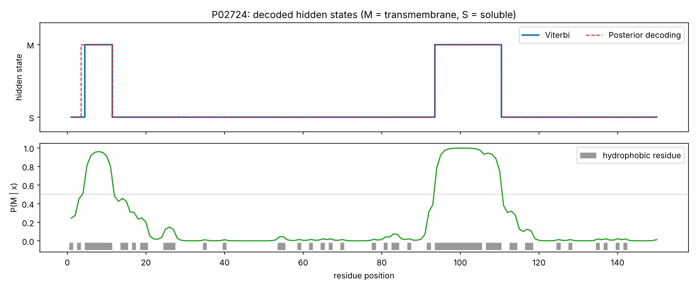
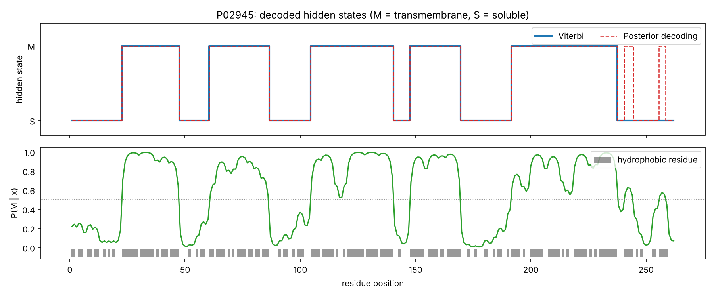

Glycophorin A is a single-pass membrane protein, and the model finds one long
M segment (94–110) in its hydrophobic middle region, `LIIFGVMAGVIGTILLI`. The
short M segment at 5–11 is the hydrophobic N-terminal signal sequence, which is
cut off in the mature protein, so it is a false positive of this simple model.
Bacteriorhodopsin has 7 transmembrane helices, but the model only finds 5 M
segments. Some helices are joined together because the loops between them are
short and still fairly hydrophobic, and with a 0.95 self-transition it is
expensive to leave M for just a few residues.

### 1b. Forward algorithm

`F_k(t) = e_k(x_t) · Σ_k' a_{k'→k} F_k'(t−1)`, `F_k(1) = e_k(x_1) P(k)`, and
`P(x) = Σ_k F_k(L)`.

| Sequence | ln P(x₁…x_L) (Forward) | P(x₁…x_L) |
|---|---|---|
| P02724 | -443.6985479990 | 2.014508 × 10^-193 |
| P02945 | -771.1757678221 | 1.209538 × 10^-335 |

### 1c. Backward algorithm

`B_k(L) = 1`, `B_k(t) = Σ_k' a_{k→k'} e_k'(x_{t+1}) B_k'(t+1)`, and
`P(x) = Σ_k P(k) e_k(x_1) B_k(1)`.

| Sequence | ln P(x₁…x_L) (Backward) | P(x₁…x_L) |
|---|---|---|
| P02724 | -443.6985479990 | 2.014508 × 10^-193 |
| P02945 | -771.1757678221 | 1.209538 × 10^-335 |

**Comparison with Forward:** yes, they are the same (the difference in
ln P(x) is about 2×10⁻¹³, which is just floating-point rounding). Both
algorithms compute P(x) = Σ_π P(x, π), the sum over all hidden-state paths π;
Forward adds up the paths from left to right and Backward from right to left.
In fact Σ_k F_k(t)B_k(t) = P(x) at every position t. I checked this for both
proteins and the largest difference over all t was about 2×10⁻¹² in log space.

### 1d. Posterior decoding

`P_k(t) = F_k(t)B_k(t) / Σ_k' F_k'(t)B_k'(t)` (computed in log space); each
position gets the state with the larger posterior.

**Output: P02724**

```
(d) Posterior-decoded path:
SSSMMMMMMMMSSSSSSSSSSSSSSSSSSSSSSSSSSSSSSSSSSSSSSSSSSSSSSSSS
SSSSSSSSSSSSSSSSSSSSSSSSSSSSSSSSSMMMMMMMMMMMMMMMMMSSSSSSSSSS
SSSSSSSSSSSSSSSSSSSSSSSSSSSSSS
    M segments (1-based): [(4, 11), (94, 110)]
    positions differing from Viterbi: 1 -> [4]
```

**Output: P02945**

```
(d) Posterior-decoded path:
SSSSSSSSSSSSSSSSSSSSSSMMMMMMMMMMMMMMMMMMMMMMMMMSSSSSSSSSSSSS
MMMMMMMMMMMMMMMMMMMMMMMMMMSSSSSSSSSSSSSSSSSSMMMMMMMMMMMMMMMM
MMMMMMMMMMMMMMMMMMMMSSSSSSSMMMMMMMMMMMMMMMMMMMMMMSSSSSSSSSSS
SSSSSSSSSSSMMMMMMMMMMMMMMMMMMMMMMMMMMMMMMMMMMMMMMMMMMMMMMSSS
MMMMSSSSSSSSSSSMMMSSSS
    M segments (1-based): [(23, 47), (61, 86), (105, 140), (148, 169), (192, 237), (241, 244), (256, 258)]
    positions differing from Viterbi: 7 -> [241, 242, 243, 244, 256, 257, 258]
```

**Comparison with Viterbi:** they are very similar but not the same. For
P02724 they differ at 1 position (residue 4: M in posterior decoding, S in
Viterbi). For P02945 they differ at 7 positions: posterior decoding has two
extra short M segments at 241–244 and 256–258.

The reason is that they answer different questions. Viterbi finds the single
most probable *whole path*. A short M segment needs two state switches, which
multiply the path probability by 0.05² = 0.0025, and a few hydrophobic residues
do not make up for that, so Viterbi stays in S. Posterior decoding instead picks
the most likely state *at each position on its own*, summing over all paths. In
the hydrophobic patches near the C-terminus of bacteriorhodopsin, P(M | x) is
only slightly above 0.5 (about 0.55–0.62 in the plot), so these positions are
called M. Putting these position-wise best states together does not have to give
the most probable path (in general it can even give a path with zero
probability). In the clear transmembrane regions the two methods agree exactly;
they only differ where P(M | x) is close to 0.5.

---

## Question 2: Progressive Multiple Sequence Alignment Construction

### Source code (`src/q2_msa.py`)

I wrote one global alignment function, `align_profiles(A, B)`, which aligns
two *profiles* (lists of already-aligned strings of equal length). A single
sequence is just a profile with one row, so the same function covers:

* (a) sequence-to-sequence alignment (|A| = |B| = 1), which is exactly
  Needleman–Wunsch with s = +3/−3/−2;
* (b) sequence-to-profile alignment, using
  S(x, C) = (1/m) Σ_{c∈C} s(x, c) with s(−,−) = 0;
* (d) profile-to-profile alignment, using
  S(C_i, C_j) = 1/(|C_i||C_j|) Σ s(a, b).

A gap in one profile means a gap column is added to every sequence in that
profile. It is scored against the other column as the average of s(−, b), so
existing gaps score 0 and residues score −2. The first row and column hold
cumulative gap penalties, the traceback goes from the bottom-right corner back
to (0, 0), and ties are broken as diagonal > up > left. To keep it fast, all
column-pair scores are computed at once from character counts
(`counts_A · M · counts_Bᵀ / (|A||B|)`); the whole Q2 script runs in about
13 seconds.

```python
"""COMP3353 A3 Q2: simplified progressive multiple sequence alignment.

(a) Needleman-Wunsch global alignment of two sequences
(b) sequence-to-profile alignment
(c) pairwise identity distances + UPGMA guide tree
(d) progressive MSA (profile-to-profile alignment following the guide tree)

Scoring: s(a,b) = +3 if a == b, -3 if a != b (both residues),
         -2 if exactly one is a gap, 0 if both are gaps.

Sequence-to-sequence and sequence-to-profile alignment are both special
cases of the general profile-to-profile DP implemented in `align_profiles`
(a single sequence is a profile with one row), so one DP is used throughout.

Usage:
    python q2_msa.py                       # runs every part on the course data
    python q2_msa.py some_file.fa          # progressive MSA (part d) of any FASTA
"""
import os
import sys

import numpy as np
import matplotlib

matplotlib.use("Agg")
import matplotlib.pyplot as plt

MATCH, MISMATCH, GAP = 3, -3, -2
GAP_CHAR = "-"

HERE = os.path.dirname(os.path.abspath(__file__))
DATA = os.path.join(HERE, "..", "data", "Q2")
RESULTS = os.path.join(HERE, "..", "results")


def s(a, b):
    """Pairwise scoring function between two characters (residue or gap)."""
    if a == GAP_CHAR and b == GAP_CHAR:
        return 0
    if a == GAP_CHAR or b == GAP_CHAR:
        return GAP
    return MATCH if a == b else MISMATCH


def read_fasta(path):
    """Return list of (name, sequence). Name = first header token; for
    UniProt headers (sp|ACC|ENTRY) the entry name, e.g. HBA_HUMAN."""
    recs, name, buf = [], None, []
    with open(path) as f:
        for line in f:
            line = line.strip()
            if not line:
                continue
            if line.startswith(">"):
                if name is not None:
                    recs.append((name, "".join(buf)))
                tok = line[1:].split()[0]
                name = tok.split("|")[2] if tok.count("|") == 2 else tok
                buf = []
            else:
                buf.append(line.upper())
    if name is not None:
        recs.append((name, "".join(buf)))
    return recs


# --------------------------------------------------------------- core DP
def column_score_matrix(A, B):
    """S[i, j] = average s(a, b) over a in column i of profile A and b in
    column j of profile B, i.e. S(C_i, C_j) = 1/(|C_i||C_j|) sum s(a, b).

    Computed with character-count vectors:  S = cA @ M @ cB^T / (|A||B|).
    """
    alphabet = sorted(set("".join(A)) | set("".join(B)) | {GAP_CHAR})
    idx = {c: k for k, c in enumerate(alphabet)}
    M = np.array([[s(a, b) for b in alphabet] for a in alphabet], dtype=float)

    def counts(P):
        C = np.zeros((len(P[0]), len(alphabet)))
        for row in P:
            for i, ch in enumerate(row):
                C[i, idx[ch]] += 1
        return C

    cA, cB = counts(A), counts(B)
    pair = cA @ M @ cB.T / (len(A) * len(B))
    # score of a column against an inserted all-gap column
    gapA = cA @ M[:, idx[GAP_CHAR]] / len(A)      # column of A vs gap column
    gapB = cB @ M[:, idx[GAP_CHAR]] / len(B)      # column of B vs gap column
    return pair, gapA, gapB


def align_profiles(A, B):
    """Global (Needleman-Wunsch) alignment of profile A (list of equal-length
    aligned strings) with profile B. Returns (merged profile rows A+B, score).

    D(i,j) = max{ D(i-1,j-1) + S(A_i, B_j),
                  D(i-1,j)   + S(A_i, gap column),   # gap inserted into all of B
                  D(i,j-1)   + S(gap column, B_j) }  # gap inserted into all of A
    Tie-breaking order: diagonal > up > left.
    """
    pair, gapA, gapB = column_score_matrix(A, B)
    n, m = len(A[0]), len(B[0])
    D = np.zeros((n + 1, m + 1))
    T = np.zeros((n + 1, m + 1), dtype=np.int8)   # 0 diag, 1 up, 2 left
    D[1:, 0] = np.cumsum(gapA)
    D[0, 1:] = np.cumsum(gapB)
    T[1:, 0] = 1
    T[0, 1:] = 2
    for i in range(1, n + 1):
        for j in range(1, m + 1):
            diag = D[i - 1, j - 1] + pair[i - 1, j - 1]
            up = D[i - 1, j] + gapA[i - 1]
            left = D[i, j - 1] + gapB[j - 1]
            best = diag
            t = 0
            if up > best + 1e-9:
                best, t = up, 1
            if left > best + 1e-9:
                best, t = left, 2
            D[i, j] = best
            T[i, j] = t
    # traceback from bottom-right to top-left
    i, j = n, m
    colsA, colsB = [], []
    while i > 0 or j > 0:
        t = T[i, j]
        if t == 0:
            colsA.append(i - 1); colsB.append(j - 1); i -= 1; j -= 1
        elif t == 1:
            colsA.append(i - 1); colsB.append(None); i -= 1
        else:
            colsA.append(None); colsB.append(j - 1); j -= 1
    colsA.reverse(); colsB.reverse()
    newA = ["".join(GAP_CHAR if c is None else r[c] for c in colsA) for r in A]
    newB = ["".join(GAP_CHAR if c is None else r[c] for c in colsB) for r in B]
    return newA + newB, D[n, m]


# --------------------------------------------------------------- (a)
def needleman_wunsch(x, y):
    (ax, ay), score = align_profiles([x], [y])
    return ax, ay, score


# --------------------------------------------------------------- (b)
def align_seq_to_profile(profile, q):
    rows, score = align_profiles(profile, [q])
    return rows, score


# --------------------------------------------------------------- (c)
def identity_distance(ax, ay):
    same = sum(1 for a, b in zip(ax, ay) if a == b and a != GAP_CHAR)
    return 1 - same / len(ax)


def distance_matrix(recs):
    n = len(recs)
    Dm = np.zeros((n, n))
    for i in range(n):
        for j in range(i + 1, n):
            ax, ay, _ = needleman_wunsch(recs[i][1], recs[j][1])
            Dm[i, j] = Dm[j, i] = identity_distance(ax, ay)
    return Dm


def upgma(names, Dm):
    """Return list of merges [(clusterA, clusterB, distance)], where each
    cluster is a tuple of sequence names. Cluster distance = average of all
    pairwise distances between members (UPGMA)."""
    pos = {n: k for k, n in enumerate(names)}
    clusters = [(n,) for n in names]
    merges = []

    def cdist(A, B):
        return np.mean([Dm[pos[a], pos[b]] for a in A for b in B])

    while len(clusters) > 1:
        best = None
        for i in range(len(clusters)):
            for j in range(i + 1, len(clusters)):
                d = cdist(clusters[i], clusters[j])
                if best is None or d < best[0] - 1e-12:
                    best = (d, i, j)
        d, i, j = best
        A, B = clusters[i], clusters[j]
        merges.append((A, B, d))
        clusters = [c for k, c in enumerate(clusters) if k not in (i, j)]
        clusters.append(A + B)
    return merges


# --------------------------------------------------------------- (d)
def progressive_msa(recs, merges):
    seqs = dict(recs)
    profiles = {(n,): [seqs[n]] for n in seqs}      # cluster -> aligned rows
    for A, B, _ in merges:
        rows, _ = align_profiles(profiles.pop(A), profiles.pop(B))
        profiles[A + B] = rows
    (cluster, rows), = profiles.items()
    return list(zip(cluster, rows))


# --------------------------------------------------------------- output
def fmt_block(names, rows, width=None):
    w = max(len(n) for n in names)
    if width is None:
        return "\n".join(f"{n:<{w}}  {r}" for n, r in zip(names, rows))
    out = []
    L = len(rows[0])
    for k in range(0, L, width):
        out.append("\n".join(f"{n:<{w}}  {r[k:k + width]}" for n, r in zip(names, rows)))
        out.append("")
    return "\n".join(out).rstrip()


def fmt_merges(merges):
    return "\n".join(f"  step {k}: ({A!r}, {B!r})   d = {d:.4f}"
                     for k, (A, B, d) in enumerate(merges, 1))


def heatmap(names, Dm, path, title):
    fig, ax = plt.subplots(figsize=(0.55 * len(names) + 2, 0.55 * len(names) + 1.5))
    im = ax.imshow(Dm, cmap="viridis")
    ax.set_xticks(range(len(names)), names, rotation=90 if len(names) > 8 else 0)
    ax.set_yticks(range(len(names)), names)
    if len(names) <= 10:
        for i in range(len(names)):
            for j in range(len(names)):
                ax.text(j, i, f"{Dm[i, j]:.3f}", ha="center", va="center",
                        color="w" if Dm[i, j] < Dm.max() * 0.6 else "k", fontsize=9)
    fig.colorbar(im, ax=ax, label="d = 1 - identity")
    ax.set_title(title)
    fig.tight_layout()
    fig.savefig(path, dpi=150)
    plt.close(fig)


def msa_report(path, label):
    recs = read_fasta(path)
    names = [n for n, _ in recs]
    Dm = distance_matrix(recs)
    merges = upgma(names, Dm)
    msa = progressive_msa(recs, merges)
    ok = all(r.replace(GAP_CHAR, "") == dict(recs)[n] for n, r in msa)
    out = [f"Progressive MSA of {label} ({len(recs)} sequences, "
           f"alignment length {len(msa[0][1])}; residues preserved: {ok})",
           "UPGMA merge order:", fmt_merges(merges), "",
           fmt_block([n for n, _ in msa], [r for _, r in msa], width=60)]
    with open(os.path.join(RESULTS, f"q2d_{label}_msa.fasta"), "w") as fh:
        for n, r in msa:
            fh.write(f">{n}\n{r}\n")
    return "\n".join(out), names, Dm


def main():
    os.makedirs(RESULTS, exist_ok=True)
    cyt = read_fasta(os.path.join(DATA, "cytochrome_c_unaligned.fa"))
    seq = dict(cyt)
    rep = []

    # (a)
    rep.append("=" * 70 + "\n(a) Needleman-Wunsch global alignment\n" + "=" * 70)
    for other in ("S4", "S6"):
        ax, ay, sc = needleman_wunsch(seq["S1"], seq[other])
        rep.append(f"S1 vs {other}:  score = {sc:g}\n{fmt_block(['S1', other], [ax, ay])}\n")

    # (b)
    rep.append("=" * 70 + "\n(b) Sequence-to-profile alignment\n" + "=" * 70)
    ex, _ = align_seq_to_profile(["-KTAYIAKQRQISFVKSHFSRQDIL",
                                  "MKTAYIAKQRQISFVKSHFTRQ-IL"],
                                 "MKTAYIAKQREISFVKSHFSRQDIL")
    rep.append("Worked example from the handout (P1, P2 profile + Q):\n"
               + fmt_block(["P1", "P2", "Q"], ex) + "\n")
    a1, a4, _ = needleman_wunsch(seq["S1"], seq["S4"])
    prof3, sc3 = align_seq_to_profile([a1, a4], seq["S2"])
    rep.append(f"S2 aligned to profile(S1, S4): score = {sc3:g}\n"
               + fmt_block(["S1", "S4", "S2"], prof3) + "\n")
    prof4, sc4 = align_seq_to_profile(prof3, seq["S6"])
    rep.append(f"S6 aligned to profile(S1, S4, S2): score = {sc4:g}\n"
               + fmt_block(["S1", "S4", "S2", "S6"], prof4) + "\n")

    # (c)
    rep.append("=" * 70 + "\n(c) Pairwise distances + UPGMA guide tree\n" + "=" * 70)
    names = [n for n, _ in cyt]
    Dm = distance_matrix(cyt)
    w = 8
    hdr = " " * 4 + "".join(f"{n:>{w}}" for n in names)
    rows = [f"{n:<4}" + "".join(f"{v:>{w}.4f}" for v in Dm[i]) for i, n in enumerate(names)]
    merges = upgma(names, Dm)
    rep.append("Distance matrix d(x,y) = 1 - identical/alignment length:\n"
               + hdr + "\n" + "\n".join(rows) + "\n\nUPGMA merge order:\n" + fmt_merges(merges))
    heatmap(names, Dm, os.path.join(RESULTS, "q2c_cytochrome_c_distance.png"),
            "Cytochrome c pairwise distance")

    # (d)
    rep.append("\n" + "=" * 70 + "\n(d) Progressive MSA\n" + "=" * 70)
    txt, _, _ = msa_report(os.path.join(DATA, "cytochrome_c_unaligned.fa"), "cytochrome_c")
    rep.append(txt + "\n")
    txt, hnames, hD = msa_report(os.path.join(DATA, "hemoglobins_unaligned.fa"), "hemoglobins")
    rep.append(txt)
    heatmap(hnames, hD, os.path.join(RESULTS, "q2d_hemoglobins_distance.png"),
            "Hemoglobin pairwise distance")

    report = "\n".join(rep)
    print(report)
    with open(os.path.join(RESULTS, "q2_output.txt"), "w") as fh:
        fh.write(report + "\n")


if __name__ == "__main__":
    if len(sys.argv) > 1:
        os.makedirs(RESULTS, exist_ok=True)
        for p in sys.argv[1:]:
            print(msa_report(p, os.path.splitext(os.path.basename(p))[0])[0])
    else:
        main()
```

### 2a. Sequence-to-sequence alignment (Needleman–Wunsch)

**S1 vs S4: alignment score = 237**

```
S1  MGDVEKGKKIFIMKCSQCHTVEKGGKHKTGPNLHGLFGRKTGQAPGYSYTAANKNKGIIWGEDTLMEYLENPKKYIPGTKMIFVGIKKKEERADLIAYLKKATNE
S4  MGDIEKGKKIFVQKCSQCHTVEKGGKHKTGPNLHGLFGRKTGQAEGFSYTDANKNKGITWGEDTLMEYLENPKKYIPGTKMIFAGIKKKSERVDLIAYLKDATSK
```

**S1 vs S6: alignment score = 107**

```
S1  MGDVE-K-G--KK---IFIMK--CSQCHTVEKGGKHKTGPNLHGLFGRKTGQAPGYSYTAAN-KNKGIIWGEDTLM-EYLENPKKYIPGTKMIFVGIKK-KEERADLIAYLKKATNE
S6  M--TEFKAGSAKKGATLF--KTRCLQCHTVEKGGPHKVGPNLHGIFGRHSGQAEGYSYTDANIK-KNVLWDE-NNMSEYLTNPKKYIPGTKMAFGGLKKEK-DRNDLITYLKKA-CE
```

(The two lines in each block have identical lengths: 105 for S1/S4 and 117 for S1/S6.)

Check of the scores: S1 (human) vs S4 (chicken) has no gaps, 92 matches and
13 mismatches, so 92 × 3 − 13 × 3 = **237**. S1 vs S6 (yeast) has 73 matches,
24 mismatches and 20 gap positions: 219 − 72 − 40 = **107**. The S1/S6
alignment has many small gaps because of the scoring scheme: a gap only costs −2
and there is no gap-opening cost, so it is often worth adding a pair of gaps to
shift the sequences and gain extra +3 matches. An affine gap penalty would give
fewer but longer gaps.

### 2b. Sequence-to-profile alignment

First, a test on the example in the handout (profile P1/P2 plus Q). Q is
aligned without adding any new gap columns, as expected:

```
P1  -KTAYIAKQRQISFVKSHFSRQDIL
P2  MKTAYIAKQRQISFVKSHFTRQ-IL
Q   MKTAYIAKQREISFVKSHFSRQDIL
```

**S2 aligned to the profile of (S1, S4)** (score 276). The profile is the 2a S1/S4 alignment:

```
S1  MGDVEKGKKIFIMKCSQCHTVEKGGKHKTGPNLHGLFGRKTGQAPGYSYTAANKNKGIIWGEDTLMEYLENPKKYIPGTKMIFVGIKKKEERADLIAYLKKATNE
S4  MGDIEKGKKIFVQKCSQCHTVEKGGKHKTGPNLHGLFGRKTGQAEGFSYTDANKNKGITWGEDTLMEYLENPKKYIPGTKMIFAGIKKKSERVDLIAYLKDATSK
S2  MGDVEKGKKIFIMKCSQCHTVEKGGKHKTGPNLHGLFGRKTGQAPGYSYTAANKNKGITWGEDTLMEYLENPKKYIPGTKMIFVGIKKKEERADLIAYLKKATNE
```

**S6 aligned to the profile of (S1, S4, S2)** (score 105):

```
S1  MGDVE-K-G--KK---IFIMK--CSQCHTVEKGGKHKTGPNLHGLFGRKTGQAPGYSYTAAN-KNKGIIWGEDTLM-EYLENPKKYIPGTKMIFVGIKK-KEERADLIAYLKKATNE
S4  MGDIE-K-G--KK---IFVQK--CSQCHTVEKGGKHKTGPNLHGLFGRKTGQAEGFSYTDAN-KNKGITWGEDTLM-EYLENPKKYIPGTKMIFAGIKK-KSERVDLIAYLKDATSK
S2  MGDVE-K-G--KK---IFIMK--CSQCHTVEKGGKHKTGPNLHGLFGRKTGQAPGYSYTAAN-KNKGITWGEDTLM-EYLENPKKYIPGTKMIFVGIKK-KEERADLIAYLKKATNE
S6  M--TEFKAGSAKKGATLF--KTRCLQCHTVEKGGPHKVGPNLHGIFGRHSGQAEGYSYTDANIK-KNVLWDE-NNMSEYLTNPKKYIPGTKMAFGGLKKEK-DRNDLITYLKKA-CE
```

Whenever S6 needs a gap opposite the profile, the same gap column is added to
all of S1, S4 and S2 (e.g. the shared `-K-G--KK---` pattern).

### 2c. Pairwise similarity and guide-tree construction

All 15 pairs were aligned with the 2a algorithm, and
d(x, y) = 1 − (number of identical positions) / (alignment length), where gap
positions never count as identical.

```
Distance matrix d(x,y) = 1 - identical/alignment length:
          S1      S2      S3      S4      S5      S6
S1    0.0000  0.0095  0.1143  0.1238  0.3426  0.3761
S2    0.0095  0.0000  0.1048  0.1143  0.3333  0.3761
S3    0.1143  0.1048  0.0000  0.1048  0.3148  0.3846
S4    0.1238  0.1143  0.1048  0.0000  0.3211  0.3846
S5    0.3426  0.3333  0.3148  0.3211  0.0000  0.4286
S6    0.3761  0.3761  0.3846  0.3846  0.4286  0.0000

UPGMA merge order:
  step 1: (('S1',), ('S2',))   d = 0.0095
  step 2: (('S3',), ('S4',))   d = 0.1048
  step 3: (('S1', 'S2'), ('S3', 'S4'))   d = 0.1143
  step 4: (('S5',), ('S1', 'S2', 'S3', 'S4'))   d = 0.3280
  step 5: (('S6',), ('S5', 'S1', 'S2', 'S3', 'S4'))   d = 0.3900
```

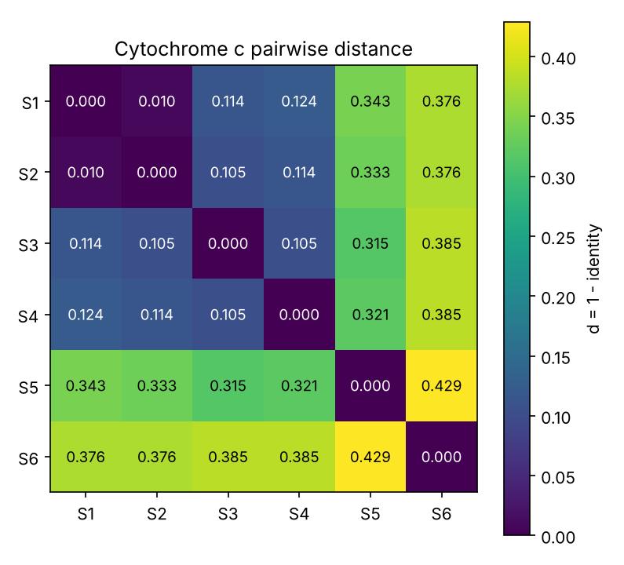

UPGMA merge order (cluster distance = average pairwise distance between members):

1. `(('S1',), ('S2',))`: human + rhesus macaque, d = 0.0095
2. `(('S3',), ('S4',))`: horse + chicken, d = 0.1048
3. `(('S1', 'S2'), ('S3', 'S4'))`: the vertebrates, d = 0.1143
4. `(('S5',), ('S1', 'S2', 'S3', 'S4'))`: add *Drosophila*, d = 0.3280
5. `(('S6',), ('S5', 'S1', 'S2', 'S3', 'S4'))`: add yeast last, d = 0.3900

The tree is ((((human, macaque), (horse, chicken)), fly), yeast). Most of it
matches the species tree: the two primates join first, then the vertebrates,
then the fly, and yeast is the outgroup. One part does not: horse should group
with the primates (both mammals) before chicken, but here horse joins chicken.
Cytochrome c is very conserved, so the vertebrate distances differ by only one
or two residues (horse–chicken 0.1048 vs horse–macaque 0.1048 vs horse–human
0.1143), which is too little to resolve this. A guide tree only needs to give a
reasonable merge order, so this does not matter much for the MSA.

### 2d. Progressive multiple sequence alignment

The script goes through the UPGMA merges in order and aligns the two clusters
with `align_profiles` each time (sequence–sequence, sequence–profile or
profile–profile, depending on the cluster sizes). As a check, removing the gaps
from every row gives back the original sequences. The MSAs are also saved as
FASTA in `results/q2d_*_msa.fasta`.

**Final MSA: `cytochrome_c_unaligned.fa`**

```
Progressive MSA of cytochrome_c (6 sequences, alignment length 120; residues preserved: True)
UPGMA merge order:
  step 1: (('S1',), ('S2',))   d = 0.0095
  step 2: (('S3',), ('S4',))   d = 0.1048
  step 3: (('S1', 'S2'), ('S3', 'S4'))   d = 0.1143
  step 4: (('S5',), ('S1', 'S2', 'S3', 'S4'))   d = 0.3280
  step 5: (('S6',), ('S5', 'S1', 'S2', 'S3', 'S4'))   d = 0.3900

S6  M----TEFKAGSAKKGATLF--KTRCLQCHTVEKGGPHKVGPNLHGIFGRHSGQAEGYSY
S5  MGSGDAE-N-G--KK---IFVQK--CAQCHTYEVGGKHKVGPNLGGVVGRKCGTAAGYKY
S1  M--GDVE-K-G--KK---IFIMK--CSQCHTVEKGGKHKTGPNLHGLFGRKTGQAPGYSY
S2  M--GDVE-K-G--KK---IFIMK--CSQCHTVEKGGKHKTGPNLHGLFGRKTGQAPGYSY
S3  M--GDVE-K-G--KK---IFVQK--CAQCHTVEKGGKHKTGPNLHGLFGRKTGQAPGFTY
S4  M--GDIE-K-G--KK---IFVQK--CSQCHTVEKGGKHKTGPNLHGLFGRKTGQAEGFSY

S6  TDANIK-KNVLWDE-NNMSEYLTNPKKYIPGTKMAFGGLKK--EKDRNDLITYLKKA-CE
S5  TDANIK-KGVTWTEGNLD-EYLKDPKKYIPGTKMVFAGLKKAEE--RADLIAFLK--SNK
S1  TAAN-KNKGIIWGEDTLM-EYLENPKKYIPGTKMIFVGIKKKEE--RADLIAYLKKATNE
S2  TAAN-KNKGITWGEDTLM-EYLENPKKYIPGTKMIFVGIKKKEE--RADLIAYLKKATNE
S3  TDAN-KNKGITWKEETLM-EYLENPKKYIPGTKMIFAGIKKKTE--REDLIAYLKKATNE
S4  TDAN-KNKGITWGEDTLM-EYLENPKKYIPGTKMIFAGIKKKSE--RVDLIAYLKDATSK
```

**Final MSA: `hemoglobins_unaligned.fa`** (29 sequences; names are UniProt entry names)

```
Progressive MSA of hemoglobins (29 sequences, alignment length 196; residues preserved: True)
UPGMA merge order:
  step 1: (('HBB_HUMAN',), ('HBB_PANTR',))   d = 0.0000
  step 2: (('HBB_MACAR',), ('HBB_MACNE',))   d = 0.0000
  step 3: (('HBG1_HUMAN',), ('HBG2_HUMAN',))   d = 0.0136
  step 4: (('HBA_HUMAN',), ('HBA_MACFU',))   d = 0.0282
  step 5: (('HBB_HUMAN', 'HBB_PANTR'), ('HBB_MACAR', 'HBB_MACNE'))   d = 0.0476
  step 6: (('HBB2_RAT',), ('HBB1_RAT',))   d = 0.0541
  step 7: (('HBB1_MOUSE',), ('HBB2_MOUSE',))   d = 0.0608
  step 8: (('HBD_HUMAN',), ('HBB_HUMAN', 'HBB_PANTR', 'HBB_MACAR', 'HBB_MACNE'))   d = 0.0680
  step 9: (('HBA_BOVIN',), ('HBA_SHEEP',))   d = 0.0699
  step 10: (('HBB2_RAT', 'HBB1_RAT'), ('HBB1_MOUSE', 'HBB2_MOUSE'))   d = 0.0997
  step 11: (('HBA_HUMAN', 'HBA_MACFU'), ('HBA_BOVIN', 'HBA_SHEEP'))   d = 0.1197
  step 12: (('HBA_MOUSE',), ('HBA_HUMAN', 'HBA_MACFU', 'HBA_BOVIN', 'HBA_SHEEP'))   d = 0.1346
  step 13: (('HBB_BOVIN',), ('HBBC_SHEEP',))   d = 0.1517
  step 14: (('HBB_PANPO',), ('HBD_HUMAN', 'HBB_HUMAN', 'HBB_PANTR', 'HBB_MACAR', 'HBB_MACNE'))   d = 0.1886
  step 15: (('HBE_HUMAN',), ('HBE_MOUSE',))   d = 0.1921
  step 16: (('HBB_BOVIN', 'HBBC_SHEEP'), ('HBB_PANPO', 'HBD_HUMAN', 'HBB_HUMAN', 'HBB_PANTR', 'HBB_MACAR', 'HBB_MACNE'))   d = 0.2044
  step 17: (('HBA_RAT',), ('HBA_MOUSE', 'HBA_HUMAN', 'HBA_MACFU', 'HBA_BOVIN', 'HBA_SHEEP'))   d = 0.2108
  step 18: (('HBG1_HUMAN', 'HBG2_HUMAN'), ('HBE_HUMAN', 'HBE_MOUSE'))   d = 0.2184
  step 19: (('HBB2_RAT', 'HBB1_RAT', 'HBB1_MOUSE', 'HBB2_MOUSE'), ('HBB_BOVIN', 'HBBC_SHEEP', 'HBB_PANPO', 'HBD_HUMAN', 'HBB_HUMAN', 'HBB_PANTR', 'HBB_MACAR', 'HBB_MACNE'))   d = 0.2248
  step 20: (('HBB1_DANRE',), ('HBB4_ONCMY',))   d = 0.2252
  step 21: (('HBA_ODOVI',), ('HBA_RAT', 'HBA_MOUSE', 'HBA_HUMAN', 'HBA_MACFU', 'HBA_BOVIN', 'HBA_SHEEP'))   d = 0.2305
  step 22: (('HBB_TACAC',), ('HBB2_RAT', 'HBB1_RAT', 'HBB1_MOUSE', 'HBB2_MOUSE', 'HBB_BOVIN', 'HBBC_SHEEP', 'HBB_PANPO', 'HBD_HUMAN', 'HBB_HUMAN', 'HBB_PANTR', 'HBB_MACAR', 'HBB_MACNE'))   d = 0.2415
  step 23: (('HBG1_HUMAN', 'HBG2_HUMAN', 'HBE_HUMAN', 'HBE_MOUSE'), ('HBB_TACAC', 'HBB2_RAT', 'HBB1_RAT', 'HBB1_MOUSE', 'HBB2_MOUSE', 'HBB_BOVIN', 'HBBC_SHEEP', 'HBB_PANPO', 'HBD_HUMAN', 'HBB_HUMAN', 'HBB_PANTR', 'HBB_MACAR', 'HBB_MACNE'))   d = 0.2719
  step 24: (('HBB_DIDVI',), ('HBG1_HUMAN', 'HBG2_HUMAN', 'HBE_HUMAN', 'HBE_MOUSE', 'HBB_TACAC', 'HBB2_RAT', 'HBB1_RAT', 'HBB1_MOUSE', 'HBB2_MOUSE', 'HBB_BOVIN', 'HBBC_SHEEP', 'HBB_PANPO', 'HBD_HUMAN', 'HBB_HUMAN', 'HBB_PANTR', 'HBB_MACAR', 'HBB_MACNE'))   d = 0.3037
  step 25: (('HBA_CHICK',), ('HBA_ODOVI', 'HBA_RAT', 'HBA_MOUSE', 'HBA_HUMAN', 'HBA_MACFU', 'HBA_BOVIN', 'HBA_SHEEP'))   d = 0.3203
  step 26: (('HBAZ_HUMAN',), ('HBA_CHICK', 'HBA_ODOVI', 'HBA_RAT', 'HBA_MOUSE', 'HBA_HUMAN', 'HBA_MACFU', 'HBA_BOVIN', 'HBA_SHEEP'))   d = 0.4237
  step 27: (('HBB1_DANRE', 'HBB4_ONCMY'), ('HBB_DIDVI', 'HBG1_HUMAN', 'HBG2_HUMAN', 'HBE_HUMAN', 'HBE_MOUSE', 'HBB_TACAC', 'HBB2_RAT', 'HBB1_RAT', 'HBB1_MOUSE', 'HBB2_MOUSE', 'HBB_BOVIN', 'HBBC_SHEEP', 'HBB_PANPO', 'HBD_HUMAN', 'HBB_HUMAN', 'HBB_PANTR', 'HBB_MACAR', 'HBB_MACNE'))   d = 0.4883
  step 28: (('HBAZ_HUMAN', 'HBA_CHICK', 'HBA_ODOVI', 'HBA_RAT', 'HBA_MOUSE', 'HBA_HUMAN', 'HBA_MACFU', 'HBA_BOVIN', 'HBA_SHEEP'), ('HBB1_DANRE', 'HBB4_ONCMY', 'HBB_DIDVI', 'HBG1_HUMAN', 'HBG2_HUMAN', 'HBE_HUMAN', 'HBE_MOUSE', 'HBB_TACAC', 'HBB2_RAT', 'HBB1_RAT', 'HBB1_MOUSE', 'HBB2_MOUSE', 'HBB_BOVIN', 'HBBC_SHEEP', 'HBB_PANPO', 'HBD_HUMAN', 'HBB_HUMAN', 'HBB_PANTR', 'HBB_MACAR', 'HBB_MACNE'))   d = 0.5763

HBAZ_HUMAN  M---S---L-TKTERTII-VS----MWA---KISTQ--AD-T-IGTETLERLFL-SHPQT
HBA_CHICK   MV-LS-A-A-DK---N-N-VK------GIFTKIAGH--AE-E-YGAETLERMFT-TYPPT
HBA_ODOVI   -V-LS-A-A-BK---S-B-VK---AAWG---KVGGN--A-AP-YGAZALZRMFL-SFPTT
HBA_RAT     MV-LS---ADDK---T-N-IK---NCWG---KIGGH--GG-E-YGEEALQRMFA-AFPTT
HBA_MOUSE   MV-LS-G-E-DK---S-N-IK---AAWG---KIGGH---GAE-YGAEALERMFA-SFPTT
HBA_HUMAN   MV-LS-P-A-DK---T-N-VK---AAWG---KVGAH--AG-E-YGAEALERMFL-SFPTT
HBA_MACFU   MV-LS-P-A-DK---S-N-VK---AAWG---KVGGH--AG-E-YGAEALERMFL-SFPTT
HBA_BOVIN   MV-LS-A-A-DK---G-N-VK---AAWG---KVGGH--A-AE-YGAEALERMFL-SFPTT
HBA_SHEEP   MV-LS-A-A-DK---S-N-VK---AAWG---KVGGN--AGA--YGAEALERMFL-SFPTT
HBB1_DANRE  MVEWTDA-E--R---T-AIL----GLWG---KL--NI--D-E-IGPQALSRC-LIVYPWT
HBB4_ONCMY  MVDWTDP-E--R---S-AIV----GLWG---K----ISVD-E-IGPQALARL-LIVSPWT
HBB_DIDVI   MVHLT-SEE--K---N-C-IT---TIWS---KV--Q--VD-Q-TGGEALGRM-LVVYPWT
HBG1_HUMAN  MGHFT--EE-DK-----A--T-ITSLWG---KV--N--V--EDAGGETLGRL-LVVYPWT
HBG2_HUMAN  MGHFT--EE-DK-----A--T-ITSLWG---KV--N--V--EDAGGETLGRL-LVVYPWT
HBE_HUMAN   MVHFT-AEE--K---A-A-VT---SLWS---KM--N--V--EEAGGEALGRL-LVVYPWT
HBE_MOUSE   MVNFT-AEE--K--------TLINGLWS---KV--N--V--EEVGGEALGRL-LVVYPWT
HBB_TACAC   MVHLS-GSE--K---T-A-VT---NLWG---HV--N--VN-E-LGGEALGRL-LVVYPWT
HBB2_RAT    MVHLTDA-E--K---A-T-VS---GLWG---KV--N--AD-N-VGAEALGRL-LVVYPWT
HBB1_RAT    MVHLTDA-E--K---A-A-VN---GLWG---KV--N--PD-D-VGGEALGRL-LVVYPWT
HBB1_MOUSE  MVHLTDA-E--K---A-A-VS---CLWG---KV--N--SD-E-VGGEALGRL-LVVYPWT
HBB2_MOUSE  MVHLTDA-E--K---S-A-VS---CLWA---KV--N--PD-E-VGGEALGRL-LVVYPWT
HBB_BOVIN   M--LT-AEE--K-----AAVT---AFWG---KV--K--VD-E-VGGEALGRL-LVVYPWT
HBBC_SHEEP  M------PN--K-----ALIT---GFWS---KV--K--VD-E-VGAEALGRL-LVVYPWT
HBB_PANPO   MSFLS-AEE--K---N-L-VS---GLWG---KV--N--VD-E-VGGEALGRL-LVVYPWT
HBD_HUMAN   MVHLT-PEE--K---T-A-VN---ALWG---KV--N--VD-A-VGGEALGRL-LVVYPWT
HBB_HUMAN   MVHLT-PEE--K---S-A-VT---ALWG---KV--N--VD-E-VGGEALGRL-LVVYPWT
HBB_PANTR   MVHLT-PEE--K---S-A-VT---ALWG---KV--N--VD-E-VGGEALGRL-LVVYPWT
HBB_MACAR   MVHLT-PEE--K---N-A-VT---TLWG---KV--N--VD-E-VGGEALGRL-LVVYPWT
HBB_MACNE   MVHLT-PEE--K---N-A-VT---TLWG---KV--N--VD-E-VGGEALGRL-LVVYPWT

HBAZ_HUMAN  KTYFPH-F-DL-HPGS---A-----QLRA-HGSKVV--A-----AVGDAVKSIDDIGGAL
HBA_CHICK   KTYFPH-F-DLSH-GS---A-----QIKG-HGKKVV--A-----ALIEAANHIDDIAGTL
HBA_ODOVI   KTYFPH-F-BLSH-GS---A-----ZVKA-HGZK-V--A---B-ALTKAVGHLBBLPGTL
HBA_RAT     KTYFSH-I-DVSP-GS---A-----QVKA-HGKK-V--A---D-ALAKAADHVEDLPGAL
HBA_MOUSE   KTYFPH-F-DVSH-GS---A-----QVKG-HGKK-V--A---D-ALASAAGHLDDLPGAL
HBA_HUMAN   KTYFPH-F-DLSH-GS---A-----QVKG-HGKK-V--A---D-ALTNAVAHVDDMPNAL
HBA_MACFU   KTYFPH-F-DLSH-GS---A-----QVKG-HGKK-V--A---D-ALTLAVGHVDDMPNAL
HBA_BOVIN   KTYFPH-F-DLSH-GS---A-----QVKG-HGAK-V--A---A-ALTKAVEHLDDLPGAL
HBA_SHEEP   KTYFPH-F-DLSH-GS---A-----QVKG-HGEK-V--A---A-ALTKAVGHLDDLPGTL
HBB1_DANRE  QRYF-ATFGNLS---SPA-AIMGNPKV-AAHGRT-VMG--GLERAI-KN---MDNVKNTY
HBB4_ONCMY  QRHF-STFGNLS---TPA-AIMGNPAV-AKHGKT-VMH--GLDRAV-QN---LDDIKNTY
HBB_DIDVI   TRFFGS-FGDLS---S-PGAVMSNSKVQA-HGAK-VLTSFG-E-AV-K---HLDNLKGTY
HBG1_HUMAN  QRFFDS-FGNLS---S-ASAIMGNPKVKA-HGKK-VLTSLG-D-AT-K---HLDDLKGTF
HBG2_HUMAN  QRFFDS-FGNLS---S-ASAIMGNPKVKA-HGKK-VLTSLG-D-AI-K---HLDDLKGTF
HBE_HUMAN   QRFFDS-FGNLS---S-PSAILGNPKVKA-HGKK-VLTSFG-D-AI-K---NMDNLKPAF
HBE_MOUSE   QRFFDS-FGNLS---S-ASAIMGNPRVKA-HGKK-VLTAFG-E-SI-K---NLDNLKSAL
HBB_TACAC   QRFFES-FGDLS---S-ADAVMGNAKVKA-HGAK-VLTSFG-D-AL-KN---LDNLKGTF
HBB2_RAT    QRYF-SKFGDLS---S-ASAIMGNPQVKA-HGKK-VINAFN-D-GL-K---HLDNLKGTF
HBB1_RAT    QRYFDS-FGDLS---S-ASAIMGNPKVKA-HGKK-VINAFN-D-GL-K---HLDNLKGTF
HBB1_MOUSE  QRYFDS-FGDLS---S-ASAIMGNAKVKA-HGKK-VITAFN-D-GL--N--HLDSLKGTF
HBB2_MOUSE  QRYFDS-FGDLS---S-ASAIMGNPKVKA-HGKK-VITAFN-E-GL-KN---LDNLKGTF
HBB_BOVIN   QRFFES-FGDLS---T-ADAVMNNPKVKA-HGKK-VLDSFS-N-GM--K--HLDDLKGTF
HBBC_SHEEP  QRFFEH-FGDLS---T-ADAVLGNAKVKA-HGKK-VLDSFS-N-GV--Q--HLDDLKGTF
HBB_PANPO   QRFFQS-FGDLS---S-ADAIMSNAKVKA-HGKK-VLNSFS-D-GL-KN---IDDLKGAF
HBD_HUMAN   QRFFES-FGDLS---S-PDAVMGNPKVKA-HGKK-VLGAFS-D-GL--A--HLDNLKGTF
HBB_HUMAN   QRFFES-FGDLS---T-PDAVMGNPKVKA-HGKK-VLGAFS-D-GL--A--HLDNLKGTF
HBB_PANTR   QRFFES-FGDLS---T-PDAVMGNPKVKA-HGKK-VLGAFS-D-GL--A--HLDNLKGTF
HBB_MACAR   QRFFES-FGDLS---S-PDAVMGNPKVKA-HGKK-VLGAFS-D-GL--N--HLDNLKGTF
HBB_MACNE   QRFFES-FGDLS---S-PDAVMGNPKVKA-HGKK-VLGAFS-D-GL--N--HLDNLKGTF

HBAZ_HUMAN  SK-LSELHAYILRVDPVNF-KLLSHCLL-VT-LAARFP-ADFT-AEA-H-AAWDKF--L-
HBA_CHICK   SK-LSDLHAHKLRVDPVNF-KLLGQCFL-VV-VAIHHP-AALTPE-V-H-ASLDKF--LC
HBA_ODOVI   SB-LSBLHAHKLRVBPVBF-KLLSHSLL-VT-LATHLP-BBFTPA-V-H-ASLBKF--L-
HBA_RAT     ST-LSDLHAHKLRVDPVNF-KFLSHCLL-VT-LACHHP-GDFTPA-M-H-ASLDKF--L-
HBA_MOUSE   SA-LSDLHAHKLRVDPVNF-KLLSHCLL-VT-LASHHP-ADFTPA-V-H-ASLDKF--L-
HBA_HUMAN   SA-LSDLHAHKLRVDPVNF-KLLSHCLL-VT-LAAHLP-AEFTPA-V-H-ASLDKF--L-
HBA_MACFU   SA-LSDLHAHKLRVDPVNF-KLLSHCLL-VT-LAAHLP-AEFTPA-V-H-ASLDKF--L-
HBA_BOVIN   SE-LSDLHAHKLRVDPVNF-KLLSHSLL-VT-LASHLP-SDFTPA-V-H-ASLDKF--L-
HBA_SHEEP   SD-LSDLHAHKLRVDPVNF-KLLSHSLL-VT-LACHLP-NDFTPA-V-H-ASLDKF--L-
HBB1_DANRE  AA-LSVMHSEKLHVDPDNF-RLLADC-ITVC-AAMKFGQAGFNAD-V-QEA-WQKFLAVV
HBB4_ONCMY  TA-LSVMHSEKLHVDPDNF-RLLADC-ITVCVAA-KLGPAVFSAD-T-QEA-FQKFLAVV
HBB_DIDVI   -AKLSELHCDKLHVDPENF-KMLGNI-I-VICLAEHFG-KDFTPE-C-QVA-WQK---LV
HBG1_HUMAN  -AQLSELHCDKLHVDPENF-KLLGNV-L-VTVLAIHFG-KEFTPE-V-Q-ASWQK---MV
HBG2_HUMAN  -AQLSELHCDKLHVDPENF-KLLGNV-L-VTVLAIHFG-KEFTPE-V-Q-ASWQK---MV
HBE_HUMAN   -AKLSELHCDKLHVDPENF-KLLGNV-M-VIILATHFG-KEFTPE-V-Q-AAWQK---LV
HBE_MOUSE   -AKLSELHCDKLHVDPENF-KLLGNV-L-VIVLASHFG-NEFTAE-M-Q-AAWQK---LV
HBB_TACAC   -AKLSELHCDKLHVDPENFNR-LGNV-L-VVVLARHFS-KEFTPE-A-Q-AAWQK---LV
HBB2_RAT    -AHLSELHCDKLHVDPENF-RLLGNM-I-VIVLGHHLG-KEFTPC-A-Q-AAFQK---VV
HBB1_RAT    -AHLSELHCDKLHVDPENF-RLLGNM-I-VIVLGHHLG-KEFTPC-A-Q-AAFQK---VV
HBB1_MOUSE  -ASLSELHCDKLHVDPENF-RLLGNM-I-VIVLGHHLG-KDFTPA-A-Q-AAFQK---VV
HBB2_MOUSE  -ASLSELHCDKLHVDPENF-RLLGNA-I-VIVLGHHLG-KDFTPA-A-Q-AAFQK---VV
HBB_BOVIN   -AALSELHCDKLHVDPENF-KLLGNV-L-VVVLARNFG-KEFTP--VLQ-ADFQK---VV
HBBC_SHEEP  -AQLSELHCDKLHVDPENF-RLLGNV-L-VVVLARHFG-KEFTP--ELQ-AEFQK---VV
HBB_PANPO   -AKLSELHCDKLHVDPENF-RLLGNV-L-VCVLAHHFG-HEFNPQ-V-Q-AAFQK---VV
HBD_HUMAN   -SQLSELHCDKLHVDPENF-RLLGNV-L-VCVLARNFG-KEFTPQ-M-Q-AAYQK---VV
HBB_HUMAN   -ATLSELHCDKLHVDPENF-RLLGNV-L-VCVLAHHFG-KEFTPP-V-Q-AAYQK---VV
HBB_PANTR   -ATLSELHCDKLHVDPENF-RLLGNV-L-VCVLAHHFG-KEFTPP-V-Q-AAYQK---VV
HBB_MACAR   -AQLSELHCDKLHVDPENF-KLLGNV-L-VCVLAHHFG-KEFTPQ-V-Q-AAYQK---VV
HBB_MACNE   -AQLSELHCDKLHVDPENF-KLLGNV-L-VCVLAHHFG-KEFTPQ-V-Q-AAYQK---VV

HBAZ_HUMAN  --SVV-SSVLTEK-YR
HBA_CHICK   -A--V-GTVLTAK-YR
HBA_ODOVI   -AB-V-STVLTSK-YR
HBA_RAT     -AS-V-STVLTSK-YR
HBA_MOUSE   -AS-V-STVLTSK-YR
HBA_HUMAN   -AS-V-STVLTSK-YR
HBA_MACFU   -AS-V-STVLTSK-YR
HBA_BOVIN   -AN-V-STVLTSK-YR
HBA_SHEEP   -AN-V-STVLTSK-YR
HBB1_DANRE  ----V-S-AL-CRQYH
HBB4_ONCMY  ----V-S-AL-GRQYH
HBB_DIDVI   -AG-VAH-ALAHK-YH
HBG1_HUMAN  TA--VAS-ALSSR-YH
HBG2_HUMAN  TG--VAS-ALSSR-YH
HBE_HUMAN   SA--VAI-ALAHK-YH
HBE_MOUSE   -AG-VAT-ALSHK-YH
HBB_TACAC   -SG-V-SHALAHK-YH
HBB2_RAT    -AG-VAS-ALAHK-YH
HBB1_RAT    -AG-VAS-ALAHK-YH
HBB1_MOUSE  -AG-VAT-ALAHK-YH
HBB2_MOUSE  -AG-VAT-ALAHK-YH
HBB_BOVIN   -AG-VAN-ALAHR-YH
HBBC_SHEEP  -AG-VAS-ALAHR-YH
HBB_PANPO   -AG-VAS-ALAHR-YH
HBD_HUMAN   -AG-VAN-ALAHK-YH
HBB_HUMAN   -AG-VAN-ALAHK-YH
HBB_PANTR   -AG-VAN-ALAHK-YH
HBB_MACAR   -AG-VAN-ALAHK-YH
HBB_MACNE   -AG-VAN-ALAHK-YH
```

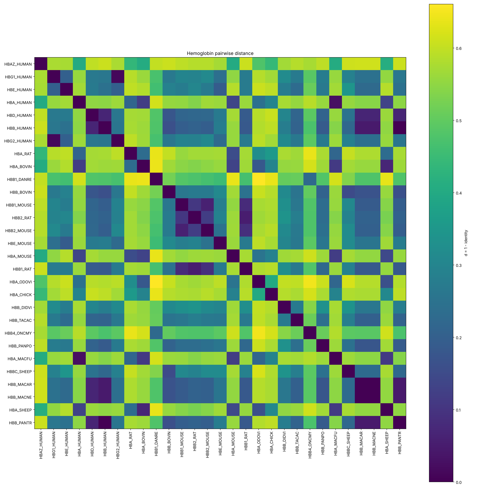

The hemoglobin guide tree splits into an α-globin group (HBA_* and HBAZ) and
a β-like group (HBB/HBD/HBG/HBE and the two fish β chains), and the last merge
joins these two groups. Inside the β-like group, human γ1/γ2 and ε (the
embryonic/fetal globins) cluster together, separate from the adult β and δ
chains. HBA_ODOVI contains the ambiguity codes B and Z; my scoring treats them
as ordinary letters.

**"Once a gap, always a gap".** In progressive alignment, every merge is
final. A gap added while aligning two clusters goes into *all* sequences of
that cluster and is never moved or removed later; later merges can only add
more gap columns. So if a gap is put in the wrong place early on (when only a
few sequences are available to decide), that mistake stays in the final MSA,
even if sequences added later would clearly show a better place for it. This
can be seen in my hemoglobin MSA. Before the last merge, the α group (9
sequences) was 156 columns long and the β-like group (20 sequences) was 174
columns. The last merge joins two distant groups (d = 0.58), and because gaps
are cheap with this scoring, it added 40 gap columns to every α sequence and
22 to every β sequence. Many of these are single-gap columns scattered through
the N-terminal half, and every sequence in each group is forced to carry them.

**Idea to overcome it: iterative refinement** (used by e.g. MUSCLE). After
the progressive MSA is built, repeatedly cut the guide tree at one edge (or
take out one sequence), delete the columns that become all-gap, and realign the
two parts with profile–profile alignment. The new MSA is kept only if its
sum-of-pairs score improves. This way gaps placed early can still be moved or
removed. Two other options are consistency-based scoring as in T-Coffee
(score a residue pair by how many other sequences support it, so the early
merges already use information from all sequences), and a better gap model as
in ClustalW (affine gaps, and a lower penalty where a profile already has gaps,
so new gaps line up with old ones).

---

## Question 3: Spatial transcriptomics data analysis

### Source code (`src/q3_spatial.py`)

```python
"""COMP3353 A3 Q3: spatial transcriptomics analysis of DLPFC slide 151673.

(a) QC + preprocessing  (b) kNN graph, UMAP, Leiden, ARI
(c) spatially smoothed clustering  (d) spatial marker gene discovery

Usage:  python q3_spatial.py        (run from anywhere; paths are relative to A3/)
"""
import os
import warnings

warnings.filterwarnings("ignore")

import cv2
import numpy as np
import pandas as pd
import scipy.sparse as sp
import scanpy as sc
import matplotlib

matplotlib.use("Agg")
import matplotlib.pyplot as plt
from scipy.spatial import cKDTree
from sklearn.metrics import adjusted_rand_score, roc_auc_score

HERE = os.path.dirname(os.path.abspath(__file__))
DATA = os.path.join(HERE, "..", "data", "Q3")
RES = os.path.join(HERE, "..", "results")
SEED = 0

# ---- chosen parameters -----------------------------------------------------
MIN_UMI = 500          # spot filter (Layer 1 is naturally low-UMI, median ~1.7k)
MIN_CELLS = 10         # gene filter
N_HVG = 3000
N_PCS = 30
N_NEIGHBORS = 15
RESOLUTIONS = [0.1, 0.2, 0.3, 0.4, 0.5, 0.6, 0.7, 0.8]
RES_B = 0.8            # unsmoothed Leiden resolution (-> 6 clusters)
SELF_W = 0.5           # smoothing: 50% own PCs + 50% mean of hex neighbours
HEX_RADIUS = 31        # px; nearest-neighbour spacing is ~20.6 px, next ring ~35.7 px
RES_C = 0.3            # smoothed Leiden resolution (-> 6 clusters)
LAYER_ORDER = ["Layer1", "Layer2", "Layer3", "Layer4", "Layer5", "Layer6", "WM"]

log_lines = []


def log(*a):
    s = " ".join(str(x) for x in a)
    print(s)
    log_lines.append(s)


# ----------------------------------------------------------------- plotting
IMG = None


def tissue_image():
    global IMG
    if IMG is None:
        IMG = cv2.cvtColor(cv2.imread(os.path.join(DATA, "151673_tissue_hires_image.png")),
                           cv2.COLOR_BGR2RGB)
    return IMG


def spatial_plot(adata, ax, values=None, categories=None, title="", cmap="viridis",
                 order=None, s=11):
    """Scatter spots over the H&E image. As in the handout snippet, the
    'x' coordinate is the image row and 'y' the image column -> scatter(y, x)."""
    ax.imshow(tissue_image(), alpha=0.55)
    x, y = adata.obsm["spatial"][:, 0], adata.obsm["spatial"][:, 1]
    if categories is not None:
        cats = order or sorted(pd.unique(categories), key=str)
        colors = plt.get_cmap("tab10" if len(cats) <= 10 else "tab20")
        for k, cat in enumerate(cats):
            m = np.asarray(categories) == cat
            ax.scatter(y[m], x[m], s=s, color=colors(k), label=str(cat), linewidths=0)
        ax.legend(markerscale=3, fontsize=8, loc="upper right", frameon=True)
    else:
        lo, hi = np.percentile(values, [1, 99])
        sca = ax.scatter(y, x, c=values, s=s, cmap=cmap, linewidths=0, vmin=lo, vmax=hi)
        plt.colorbar(sca, ax=ax, fraction=0.046, pad=0.02)
    ax.set_xlim(y.min() - 60, y.max() + 60)
    ax.set_ylim(x.max() + 60, x.min() - 60)
    ax.set_title(title)


def save_pair(adata, left, right, fname, ltitle, rtitle, rorder=None):
    fig, axes = plt.subplots(1, 2, figsize=(16, 8))
    spatial_plot(adata, axes[0], categories=left, title=ltitle, order=LAYER_ORDER)
    spatial_plot(adata, axes[1], categories=right, title=rtitle, order=rorder)
    fig.tight_layout()
    fig.savefig(os.path.join(RES, fname), dpi=110)
    plt.close(fig)


def leiden(adata, res, key):
    sc.tl.leiden(adata, resolution=res, flavor="igraph", n_iterations=2,
                 directed=False, random_state=SEED, key_added=key)


# ----------------------------------------------------------------- (a)
def part_a():
    log("=" * 70 + "\n(a) QC and preprocessing\n" + "=" * 70)
    adata = sc.read_10x_h5(os.path.join(DATA, "151673_raw_feature_bc_matrix.h5"))
    adata.var_names_make_unique()
    coord = pd.read_csv(os.path.join(DATA, "151673_spot_coordinates.csv"), index_col=0)
    ann = pd.read_csv(os.path.join(DATA, "151673_annotations.csv"), index_col=0)
    log(f"raw matrix: {adata.n_obs} barcodes x {adata.n_vars} genes")

    adata = adata[coord.index].copy()
    adata.obsm["spatial"] = coord.loc[adata.obs_names, ["x", "y"]].to_numpy()
    adata.obs["layer"] = ann.loc[adata.obs_names, "layer"]
    adata = adata[adata.obs["layer"].notna()].copy()
    adata.obs["layer"] = pd.Categorical(adata.obs["layer"], categories=LAYER_ORDER)
    log(f"spots with coordinates + annotation: {adata.n_obs}")

    adata.obs["total_counts"] = np.asarray(adata.X.sum(axis=1)).ravel()
    adata.obs["n_genes"] = np.asarray((adata.X > 0).sum(axis=1)).ravel()
    q = np.percentile(adata.obs["total_counts"], [0, 1, 5, 50])
    log(f"UMI/spot: min {q[0]:.0f}, 1% {q[1]:.0f}, 5% {q[2]:.0f}, median {q[3]:.0f}")
    log("median UMI per layer: " + ", ".join(
        f"{k} {v:.0f}" for k, v in adata.obs.groupby("layer", observed=True)["total_counts"].median().items()))

    # QC histogram
    fig, ax = plt.subplots(figsize=(7, 4))
    ax.hist(np.log10(adata.obs["total_counts"]), bins=80, color="C0")
    ax.axvline(np.log10(MIN_UMI), color="r", ls="--", label=f"threshold = {MIN_UMI} UMI")
    ax.set_xlabel("log10(total UMI per spot)")
    ax.set_ylabel("# spots")
    ax.legend()
    fig.tight_layout()
    fig.savefig(os.path.join(RES, "q3a_umi_histogram.png"), dpi=130)
    plt.close(fig)

    n0 = adata.n_obs
    sc.pp.filter_cells(adata, min_counts=MIN_UMI)
    log(f"spot filter (total UMI >= {MIN_UMI}): removed {n0 - adata.n_obs}, kept {adata.n_obs}")
    g0 = adata.n_vars
    sc.pp.filter_genes(adata, min_cells=MIN_CELLS)
    log(f"gene filter (expressed in >= {MIN_CELLS} spots): kept {adata.n_vars} / {g0} genes")

    adata.layers["counts"] = adata.X.copy()
    sc.pp.normalize_total(adata, target_sum=1e4)
    sc.pp.log1p(adata)
    adata.raw = adata                   # full log-normalised matrix X (for DE)

    sc.pp.highly_variable_genes(adata, n_top_genes=N_HVG)
    hvg = adata.var_names[adata.var["highly_variable"]]
    top = adata.var.loc[hvg].sort_values("dispersions_norm", ascending=False).index[:20]
    log(f"HVGs kept: {len(hvg)} ; top 20 by normalised dispersion: {', '.join(top)}")
    adata = adata[:, hvg].copy()

    sc.pp.pca(adata, n_comps=N_PCS, random_state=SEED)
    vr = adata.uns["pca"]["variance_ratio"]
    log(f"PCA: {N_PCS} PCs, cumulative variance explained = {vr.sum():.3f} "
        f"(PC1 {vr[0]:.3f}, PC2 {vr[1]:.3f})")
    log(f"final matrix X: {adata.n_obs} spots x {adata.n_vars} HVGs; "
        f"X_pca: {adata.obsm['X_pca'].shape}")
    log("PC1 vs layer (mean): " + ", ".join(
        f"{k} {v:+.2f}" for k, v in pd.Series(adata.obsm['X_pca'][:, 0], index=adata.obs_names)
        .groupby(adata.obs["layer"], observed=True).mean().items()))

    fig, ax = plt.subplots(1, 2, figsize=(14, 5))
    ax[0].plot(np.arange(1, N_PCS + 1), vr, "o-")
    ax[0].set_xlabel("PC")
    ax[0].set_ylabel("variance ratio")
    ax[0].set_title("PCA elbow plot")
    for k, lab in enumerate(LAYER_ORDER):
        m = adata.obs["layer"] == lab
        ax[1].scatter(adata.obsm["X_pca"][m, 0], adata.obsm["X_pca"][m, 1], s=3,
                      color=plt.get_cmap("tab10")(k), label=lab)
    ax[1].set_xlabel("PC1")
    ax[1].set_ylabel("PC2")
    ax[1].legend(markerscale=4, fontsize=8)
    ax[1].set_title("PC1 vs PC2 coloured by annotation")
    fig.tight_layout()
    fig.savefig(os.path.join(RES, "q3a_pca.png"), dpi=130)
    plt.close(fig)

    fig, ax = plt.subplots(figsize=(9, 8))
    spatial_plot(adata, ax, values=adata.obsm["X_pca"][:, 0], cmap="coolwarm",
                 title="PC1 value per spot")
    fig.tight_layout()
    fig.savefig(os.path.join(RES, "q3a_pc1_spatial.png"), dpi=130)
    plt.close(fig)
    return adata


# ----------------------------------------------------------------- (b)
def part_b(adata):
    log("\n" + "=" * 70 + "\n(b) kNN graph, UMAP, Leiden\n" + "=" * 70)
    sc.pp.neighbors(adata, n_neighbors=N_NEIGHBORS, use_rep="X_pca", metric="euclidean",
                    random_state=SEED)
    sc.tl.umap(adata, random_state=SEED)
    log(f"kNN graph: k = {N_NEIGHBORS}, Euclidean distance on {N_PCS} PCs")
    log("resolution scan (resolution, #clusters, ARI):")
    for r in RESOLUTIONS:
        leiden(adata, r, "tmp")
        log(f"   {r:.1f}  {adata.obs['tmp'].nunique():2d}  "
            f"{adjusted_rand_score(adata.obs['layer'], adata.obs['tmp']):.3f}")
    del adata.obs["tmp"]
    leiden(adata, RES_B, "leiden")
    ari = adjusted_rand_score(adata.obs["layer"], adata.obs["leiden"])
    log(f"chosen resolution {RES_B}: {adata.obs['leiden'].nunique()} clusters, ARI = {ari:.4f}")
    log("contingency (rows = cluster):\n" +
        pd.crosstab(adata.obs["leiden"], adata.obs["layer"]).to_string())

    fig, ax = plt.subplots(1, 2, figsize=(13, 5.5))
    for a, key, title in ((ax[0], "layer", "UMAP: ground truth"),
                          (ax[1], "leiden", f"UMAP: Leiden (res {RES_B})")):
        cats = adata.obs[key].cat.categories
        for k, c in enumerate(cats):
            m = adata.obs[key] == c
            a.scatter(*adata.obsm["X_umap"][m].T, s=3, color=plt.get_cmap("tab10")(k), label=c)
        a.legend(markerscale=4, fontsize=8)
        a.set_title(title)
        a.set_xticks([]); a.set_yticks([])
    fig.tight_layout()
    fig.savefig(os.path.join(RES, "q3b_umap.png"), dpi=130)
    plt.close(fig)

    save_pair(adata, adata.obs["layer"], adata.obs["leiden"], "q3b_spatial_clusters.png",
              "Ground truth annotation", f"Leiden clusters (res {RES_B}), ARI = {ari:.3f}",
              rorder=list(adata.obs["leiden"].cat.categories))
    return ari


# ----------------------------------------------------------------- (c)
def hex_adjacency(adata):
    """Spots within HEX_RADIUS px are immediate hex-grid neighbours (<= 6)."""
    xy = adata.obsm["spatial"]
    pairs = cKDTree(xy).query_pairs(HEX_RADIUS, output_type="ndarray")
    n = adata.n_obs
    A = sp.coo_matrix((np.ones(len(pairs)), (pairs[:, 0], pairs[:, 1])), shape=(n, n))
    return (A + A.T).tocsr()


def part_c(adata):
    log("\n" + "=" * 70 + "\n(c) Spatially smoothed clustering\n" + "=" * 70)
    A = hex_adjacency(adata)
    deg = np.asarray(A.sum(axis=1)).ravel()
    log(f"hex neighbours per spot: " +
        ", ".join(f"{k}:{v}" for k, v in sorted(pd.Series(deg).value_counts().items())))
    W = sp.diags(1.0 / np.maximum(deg, 1)) @ A                # row-normalised
    Z = adata.obsm["X_pca"]
    nb_mean = W @ Z
    has_nb = (deg > 0)[:, None]
    adata.obsm["X_smooth"] = np.where(has_nb, SELF_W * Z + (1 - SELF_W) * nb_mean, Z)

    sc.pp.neighbors(adata, n_neighbors=N_NEIGHBORS, use_rep="X_smooth", random_state=SEED,
                    key_added="smooth")
    log(f"smoothed PCs: {SELF_W:.0%} own + {1 - SELF_W:.0%} mean of hex neighbours; "
        f"kNN (k = {N_NEIGHBORS}) rebuilt on smoothed PCs")
    log("resolution scan (resolution, #clusters, ARI):")
    for r in RESOLUTIONS:
        sc.tl.leiden(adata, resolution=r, flavor="igraph", n_iterations=2, directed=False,
                     random_state=SEED, key_added="tmp", neighbors_key="smooth")
        log(f"   {r:.1f}  {adata.obs['tmp'].nunique():2d}  "
            f"{adjusted_rand_score(adata.obs['layer'], adata.obs['tmp']):.3f}")
    del adata.obs["tmp"]
    sc.tl.leiden(adata, resolution=RES_C, flavor="igraph", n_iterations=2, directed=False,
                 random_state=SEED, key_added="leiden_smooth_raw", neighbors_key="smooth")
    ari_raw = adjusted_rand_score(adata.obs["layer"], adata.obs["leiden_smooth_raw"])
    log(f"step 1 (feature smoothing), res {RES_C}: "
        f"{adata.obs['leiden_smooth_raw'].nunique()} clusters, ARI = {ari_raw:.4f}")

    # step 2: label refinement - majority vote among a spot and its hex neighbours
    labels = adata.obs["leiden_smooth_raw"].astype(int).to_numpy()
    k = labels.max() + 1
    onehot = sp.csr_matrix((np.ones(len(labels)), (np.arange(len(labels)), labels)),
                           shape=(len(labels), k))
    votes = (A + sp.identity(A.shape[0])) @ onehot
    votes = votes.toarray()
    new = labels.copy()
    own = votes[np.arange(len(labels)), labels]
    best = votes.argmax(axis=1)
    flip = votes.max(axis=1) > own          # neighbourhood majority disagrees
    new[flip] = best[flip]
    adata.obs["leiden_smooth"] = pd.Categorical(new.astype(str),
                                                categories=sorted(set(new.astype(str)), key=int))
    ari = adjusted_rand_score(adata.obs["layer"], adata.obs["leiden_smooth"])
    log(f"step 2 (neighbour majority vote on labels): {flip.sum()} spots relabelled, "
        f"{adata.obs['leiden_smooth'].nunique()} clusters, ARI = {ari:.4f}")
    log("contingency (rows = smoothed cluster):\n" +
        pd.crosstab(adata.obs["leiden_smooth"], adata.obs["layer"]).to_string())

    save_pair(adata, adata.obs["layer"], adata.obs["leiden_smooth"],
              "q3c_spatial_smoothed_clusters.png", "Ground truth annotation",
              f"Spatially smoothed Leiden (res {RES_C}), ARI = {ari:.3f}",
              rorder=list(adata.obs["leiden_smooth"].cat.categories))
    return ari


# ----------------------------------------------------------------- (d)
def match_cluster(adata, key, layer):
    """Cluster with the highest Jaccard overlap with a ground-truth layer."""
    gt = adata.obs["layer"] == layer
    best = None
    for c in adata.obs[key].cat.categories:
        m = adata.obs[key] == c
        j = (gt & m).sum() / (gt | m).sum()
        if best is None or j > best[1]:
            best = (c, j)
    return best


def top_degs(adata, groupby, group, n=10):
    sc.tl.rank_genes_groups(adata, groupby=groupby, groups=[group], reference="rest",
                            method="wilcoxon", use_raw=True, key_added="rg")
    df = sc.get.rank_genes_groups_df(adata, group=group, key="rg")
    df = df[df["logfoldchanges"] > 0]                   # up-regulated markers
    return df.head(n).reset_index(drop=True)


def gene_expr(adata, g):
    """Log-normalised expression of one gene (from adata.raw) as a 1-D array."""
    x = adata.raw[:, g].X
    return np.asarray(x.todense()).ravel() if sp.issparse(x) else np.asarray(x).ravel()


def part_d(adata):
    log("\n" + "=" * 70 + "\n(d) Spatial marker genes (Wilcoxon one-vs-rest, "
        "ranked by adjusted p-value / z-score, up-regulated only)\n" + "=" * 70)
    key = "leiden_smooth"
    tables = {}
    for layer in ("WM", "Layer1"):
        tables[("gt", layer)] = top_degs(adata, "layer", layer)
        c, j = match_cluster(adata, key, layer)
        tables[("cl", layer)] = top_degs(adata, key, c)
        tables[("clid", layer)] = (c, j)

    def show(df):
        return df[["names", "scores", "logfoldchanges", "pvals_adj"]].to_string(
            index=False, formatters={"scores": "{:.2f}".format,
                                     "logfoldchanges": "{:.2f}".format,
                                     "pvals_adj": "{:.2e}".format})

    for layer in ("WM", "Layer1"):
        c, j = tables[("clid", layer)]
        g = tables[("gt", layer)]
        k = tables[("cl", layer)]
        shared = [x for x in g["names"] if x in set(k["names"])]
        log(f"\n--- {layer}: ground-truth annotation '{layer}' vs rest ---\n{show(g)}")
        log(f"\n--- smoothed cluster {c} (best Jaccard match to {layer}, J = {j:.2f}) vs rest ---\n{show(k)}")
        log(f"overlap of top-10 lists: {len(shared)}/10 -> {shared}")

    wm_gene = next(x for x in tables[("gt", "WM")]["names"] if x in set(tables[("cl", "WM")]["names"]))
    l1_gene = next(x for x in tables[("gt", "Layer1")]["names"] if x in set(tables[("cl", "Layer1")]["names"]))
    log(f"\nselected representative markers: WM -> {wm_gene}, Layer1 -> {l1_gene}")

    # how well each top-10 ground-truth gene alone separates its layer from the rest
    for layer in ("WM", "Layer1"):
        y = (adata.obs["layer"] == layer).to_numpy()
        aucs = {g: roc_auc_score(y, gene_expr(adata, g)) for g in tables[("gt", layer)]["names"]}
        log(f"AUROC ({layer} vs rest): " +
            ", ".join(f"{g} {a:.3f}" for g, a in sorted(aucs.items(), key=lambda kv: -kv[1])))

    fig, axes = plt.subplots(1, 2, figsize=(17, 8))
    for ax, g, lab in ((axes[0], wm_gene, "WM"), (axes[1], l1_gene, "Layer 1")):
        expr = gene_expr(adata, g)
        spatial_plot(adata, ax, values=expr, cmap="magma_r",
                     title=f"{g} (log-normalised expression) - {lab} marker")
    fig.tight_layout()
    fig.savefig(os.path.join(RES, "q3d_marker_genes_spatial.png"), dpi=110)
    plt.close(fig)
    return tables


if __name__ == "__main__":
    os.makedirs(RES, exist_ok=True)
    sc.settings.verbosity = 0
    ad = part_a()
    part_b(ad)
    part_c(ad)
    part_d(ad)
    with open(os.path.join(RES, "q3_output.txt"), "w") as fh:
        fh.write("\n".join(log_lines) + "\n")
```

The full log is in `results/q3_output.txt`. The random seed is 0 for PCA,
neighbours, UMAP and Leiden, so the results can be reproduced.

### 3a. Quality control and preprocessing

```
raw matrix: 4992 barcodes x 33538 genes
spots with coordinates + annotation: 3611
UMI/spot: min 210, 1% 918, 5% 1510, median 4138
median UMI per layer: Layer1 1711, Layer2 4873, Layer3 5547, Layer4 4924, Layer5 4748, Layer6 3435, WM 3404
spot filter (total UMI >= 500): removed 7, kept 3604
gene filter (expressed in >= 10 spots): kept 16567 / 33538 genes
HVGs kept: 3000 ; top 20 by normalised dispersion: IGHG3, NPY, IGHG4, IGLC2, HBA1, IGHM, IGHA1, IGKC, HBA2, TF, CALD1, HBB, PTGFR, MCM3AP-AS1, TAGLN, CPB1, ZMYND15, MYL9, MOBP, TMEM144
PCA: 30 PCs, cumulative variance explained = 0.185 (PC1 0.094, PC2 0.010)
final matrix X: 3604 spots x 3000 HVGs; X_pca: (3604, 30)
PC1 vs layer (mean): Layer1 -3.32, Layer2 -3.28, Layer3 -3.38, Layer4 -2.90, Layer5 -2.11, Layer6 +0.99, WM +12.54
```

**Choices**

| Parameter | Choice | Reason |
|---|---|---|
| UMI threshold | **≥ 500 UMIs per spot** | The median is 4,138 UMIs, but Layer 1 has few cells and much lower counts (median 1,711), so a stricter cut such as 1,000–1,500 would mainly throw away real Layer 1 spots. In the histogram, 500 falls in the empty gap between a few outlier spots and the main distribution, and it removes only those 7 spots (3,611 → 3,604). |
| Gene filter | expressed in ≥ 10 spots | 16,567 / 33,538 genes kept |
| Normalization | total = 10,000 per spot, then natural `log1p` | `X` = 3,604 × 16,567 log-normalized matrix (kept in `adata.raw` for DE) |
| HVG count | **3,000** (`highly_variable_genes`, default flavour, on the log data) | In a trial run, 3,000 HVGs gave slightly higher ARI than 2,000. The most variable genes include white matter genes (MOBP, TF, TMEM144), but also immunoglobulin (IGHG3, IGKC) and hemoglobin (HBA1, HBB) genes, which probably come from blood vessels and blood cells in a few spots rather than from cortical layers. |
| PC count | **30** | The elbow plot drops sharply after PC1 and flattens after about PC5. Later PCs each explain little variance, but layer differences other than WM vs grey matter are small, so I kept 30 PCs (18.5% of the HVG variance) rather than cutting at the elbow. PC1 alone explains 9.4%. |

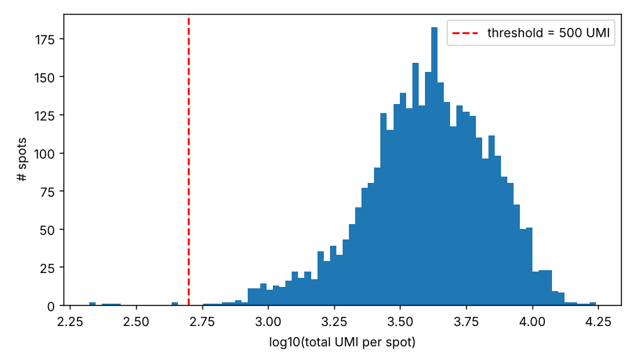
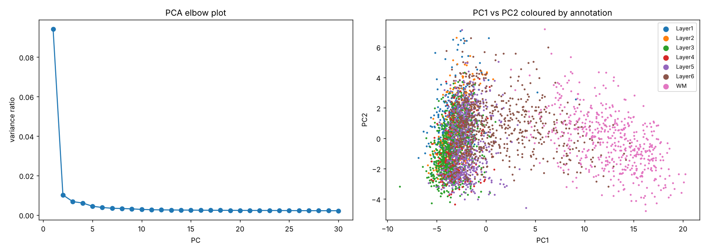

**PC1 on the tissue image.** PC1 basically separates white matter from grey
matter: the mean PC1 is +12.5 in WM, +1.0 in Layer 6 and between −2.1 and −3.4
in Layers 1–5.

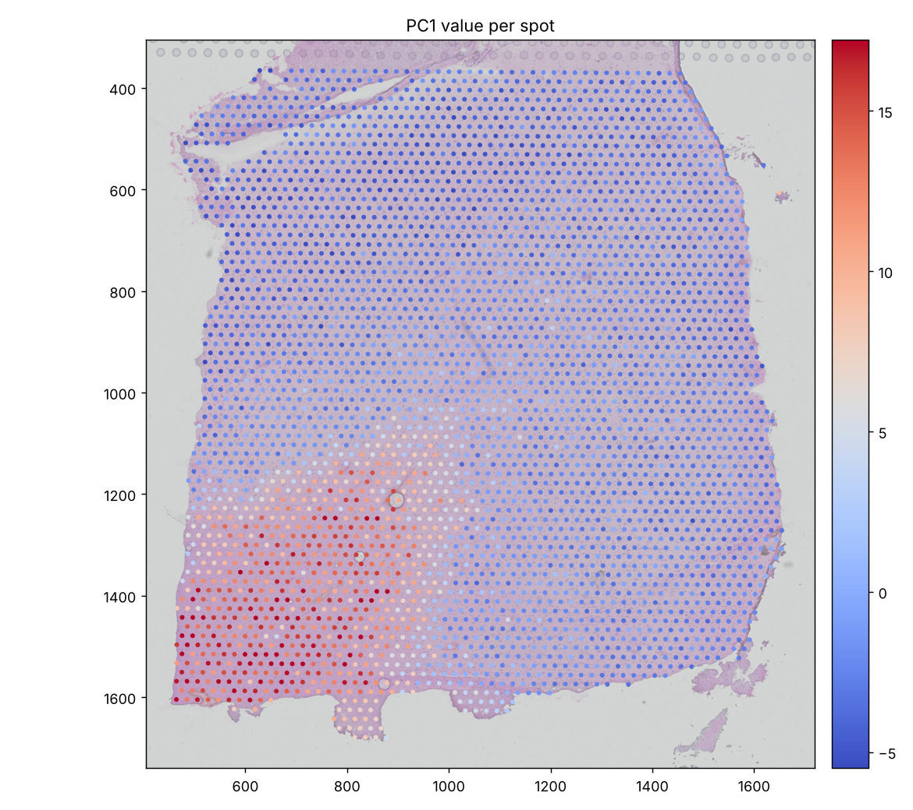

### 3b. k-NN graph and Leiden clustering

* k-NN graph: **k = 15**, Euclidean distance on the 30 PCs (`sc.pp.neighbors`).
* UMAP from that graph, followed by Leiden (igraph implementation, 2 iterations, seed 0).

```
kNN graph: k = 15, Euclidean distance on 30 PCs
resolution scan (resolution, #clusters, ARI):
   0.1   2  0.143
   0.2   2  0.144
   0.3   3  0.155
   0.4   3  0.156
   0.5   4  0.208
   0.6   5  0.222
   0.7   5  0.244
   0.8   6  0.254
chosen resolution 0.8: 6 clusters, ARI = 0.2542
```

I chose resolution **0.8, which gives 6 clusters**. Resolutions below 0.5
give only 2–3 clusters, and 0.8 is the highest value I tried that stays within
the 4–8 range.

**ARI (Leiden vs pathologist annotation) = 0.2542**

```
contingency (rows = cluster):
layer   Layer1  Layer2  Layer3  Layer4  Layer5  Layer6   WM
leiden                                                     
0           63     144     300       3      10       5    0
1          150      76     147       4       0       4    0
2           18      14     176      80     242     140    2
3           13       4      11      15     104     324    6
4            2       0       0       0       0     119  505
5           25      14     354     116     315      99    0
```

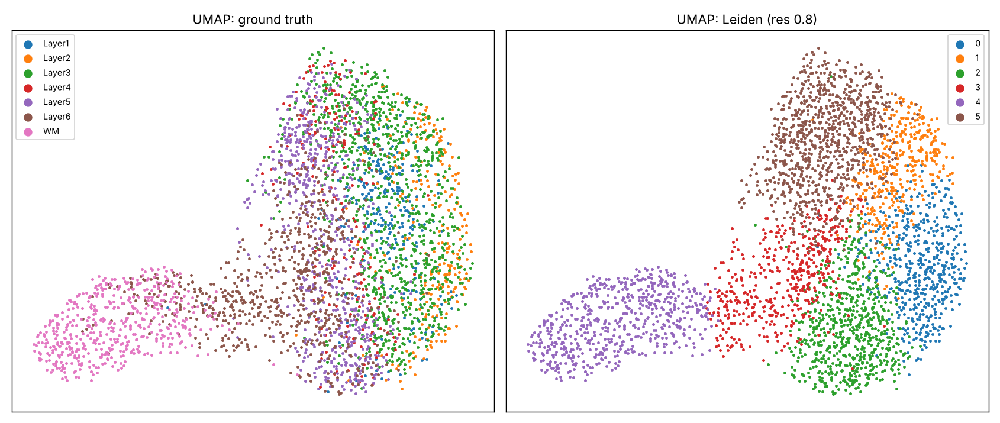
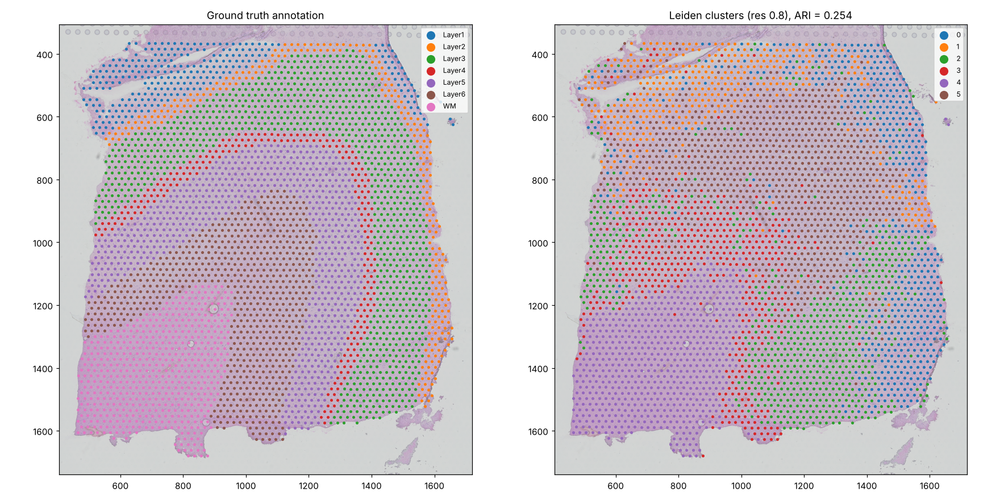

Using expression alone, WM is found well (cluster 4: 505 of its 626 spots
are WM), and cluster 3 is mostly Layer 6. The other layers are mixed:
clusters 0, 1, 2 and 5 each contain spots from three or four neighbouring
layers, and in the spatial plot their spots are scattered rather than forming
bands. This is why the ARI is only 0.25.

### 3c. Spatially smoothed clustering

**Smoothing operation (two steps):**

1. **Smoothing the PCs.** First I find each spot's hexagonal neighbours from
   the coordinates. Neighbouring spots are about 20.6 px apart and the next
   ring is about 35.7 px away, so I take all spots within 31 px as neighbours
   (at most 6; 3,274 of the 3,604 spots have all six, spots on the tissue edge
   have fewer). Then each spot's PC vector is replaced by
   **z̃_i = 0.5·z_i + 0.5·mean_{j∈N(i)} z_j**, i.e. X = 50% (own PCs) and 50%
   the average of its neighbours. The one spot with no neighbours keeps its
   own PCs. The k-NN graph (k = 15) and Leiden clustering are then run again on
   z̃. Neighbouring spots are usually in the same layer, so averaging reduces
   the noise of single spots (dropouts, different depth) but keeps the layer
   differences.
2. **Cleaning the labels.** For each spot, I count the cluster labels of the
   spot and its hex neighbours. If another label has more votes than the
   spot's own label, the spot is relabelled. This removes single isolated spots
   inside another cluster.

```
hex neighbours per spot: 0.0:1, 1.0:5, 2.0:11, 3.0:72, 4.0:128, 5.0:113, 6.0:3274
smoothed PCs: 50% own + 50% mean of hex neighbours; kNN (k = 15) rebuilt on smoothed PCs
resolution scan (resolution, #clusters, ARI):
   0.1   3  0.316
   0.2   4  0.302
   0.3   6  0.327
   0.4   7  0.296
   0.5   9  0.354
   0.6   9  0.328
   0.7  12  0.291
   0.8  12  0.302
step 1 (feature smoothing), res 0.3: 6 clusters, ARI = 0.3275
step 2 (neighbour majority vote on labels): 58 spots relabelled, 6 clusters, ARI = 0.3290
```

I chose resolution **0.3, which gives 6 clusters**, the same number as in 3b.
(Resolution 0.5 gives a higher ARI, 0.354, but 9 clusters, which is outside the
4–8 range.)

**ARI (smoothed clusters vs annotation) = 0.3290** (0.3275 after step 1 only),
compared with **0.2542** without smoothing for the same number of clusters, an
improvement of about 30%.

```
contingency (rows = smoothed cluster):
layer          Layer1  Layer2  Layer3  Layer4  Layer5  Layer6   WM
leiden_smooth                                                     
0                  39     158     435      15       0       0    0
1                 213      14       0       0       0       0    0
2                  17      80     507     108     282      29    0
3                   2       0       0       0       0     203  513
4                   0       0      28      44     188     199    0
5                   0       0      18      51     201     260    0
```

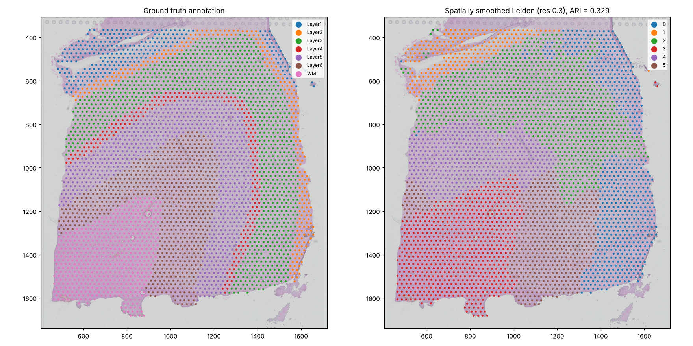

After smoothing, the clusters form continuous bands that follow the layers:
cluster 1 is Layer 1 (213 of its 227 spots), cluster 0 is mostly Layers 2–3,
cluster 2 covers Layers 3–5, clusters 4 and 5 are Layers 5–6, and cluster 3
contains all 513 WM spots plus the deepest part of Layer 6. Most of the
remaining errors are in the thin Layers 2 and 4, which are only a few spots
wide and get merged into the neighbouring bands.

### 3d. Spatial marker gene discovery

Method: one-vs-rest Wilcoxon rank-sum test (`sc.tl.rank_genes_groups`,
`method="wilcoxon"`) on all 16,567 genes of the log-normalized matrix
(`adata.raw`), with Benjamini–Hochberg adjusted p-values. Genes are ranked by
the Wilcoxon score (the same order as the adjusted p-value), keeping only genes
that are higher in the group (log fold change > 0). I ran it once with the
ground-truth labels (WM and Layer 1) and once with the smoothed clusters from
3c. For the clusters, I took the cluster with the highest Jaccard overlap with
each layer: cluster 3 for WM (the innermost one, J = 0.71) and cluster 1 for
Layer 1 (the outermost one, J = 0.75).

```
--- WM: ground-truth annotation 'WM' vs rest ---
names scores logfoldchanges pvals_adj
  MBP  35.76           3.57 8.44e-276
 PLP1  35.53           4.02 1.27e-272
CRYAB  35.07           3.63 1.02e-265
  CNP  34.86           3.72 1.39e-262
 GFAP  34.15           3.51 5.02e-252
 MOBP  33.87           4.28 4.48e-248
   TF  33.41           3.96 1.81e-241
PTGDS  33.38           2.20 5.41e-241
S100B  33.33           2.95 2.13e-240
 FTH1  33.19           1.11 2.66e-238

--- smoothed cluster 3 (best Jaccard match to WM, J = 0.71) vs rest ---
names scores logfoldchanges pvals_adj
  MBP  41.07           3.48  0.00e+00
 PLP1  40.61           3.91  0.00e+00
  CNP  38.90           3.58  0.00e+00
 GFAP  38.70           3.45  0.00e+00
CRYAB  38.36           3.40  0.00e+00
 MOBP  37.60           4.29 5.38e-306
   TF  37.56           3.95 2.16e-305
PTGDS  36.15           2.01 6.51e-283
S100B  35.86           2.75 2.45e-278
 FTH1  34.83           0.97 1.64e-262
overlap of top-10 lists: 10/10 -> ['MBP', 'PLP1', 'CRYAB', 'CNP', 'GFAP', 'MOBP', 'TF', 'PTGDS', 'S100B', 'FTH1']

--- Layer1: ground-truth annotation 'Layer1' vs rest ---
 names scores logfoldchanges pvals_adj
MALAT1  16.08           1.38  5.93e-54
 COX6C  12.02           0.75  2.20e-29
   CLU  11.62           0.45  1.71e-27
  CST3  11.32           0.49  3.30e-26
MT-ND2   9.41           0.31  4.72e-18
MT-ND3   9.33           0.29  8.43e-18
MT-ND1   8.89           0.30  3.47e-16
  GFAP   8.41           0.93  1.52e-14
MT-ND5   8.08           0.23  1.63e-13
SLC1A2   7.57           0.37  5.99e-12

--- smoothed cluster 1 (best Jaccard match to Layer1, J = 0.75) vs rest ---
 names scores logfoldchanges pvals_adj
 COX6C  14.94           1.06  2.83e-46
MALAT1  14.15           1.32  1.49e-41
   CLU  10.02           0.41  2.95e-20
  CST3   8.99           0.42  2.75e-16
MT-ND1   7.72           0.29  5.12e-12
   MGP   7.36           1.63  5.12e-11
MT-ND2   7.35           0.26  5.21e-11
  GFAP   7.30           0.88  6.99e-11
MT-ND3   7.22           0.24  1.10e-10
SLC1A2   6.86           0.34  1.04e-09
overlap of top-10 lists: 9/10 -> ['MALAT1', 'COX6C', 'CLU', 'CST3', 'MT-ND2', 'MT-ND3', 'MT-ND1', 'GFAP', 'SLC1A2']
```

**Summary of top-10 DEGs**

| Rank | WM (ground truth) | Cluster 3 (≈ WM) | Layer 1 (ground truth) | Cluster 1 (≈ Layer 1) |
|---|---|---|---|---|
| 1 | MBP | MBP | MALAT1 | COX6C |
| 2 | PLP1 | PLP1 | COX6C | MALAT1 |
| 3 | CRYAB | CNP | CLU | CLU |
| 4 | CNP | GFAP | CST3 | CST3 |
| 5 | GFAP | CRYAB | MT-ND2 | MT-ND1 |
| 6 | MOBP | MOBP | MT-ND3 | MGP |
| 7 | TF | TF | MT-ND1 | MT-ND2 |
| 8 | PTGDS | PTGDS | GFAP | GFAP |
| 9 | S100B | S100B | MT-ND5 | MT-ND3 |
| 10 | FTH1 | FTH1 | SLC1A2 | SLC1A2 |

**Consistency.** The two sets of markers are very consistent.

* **WM vs cluster 3: all 10 genes are shared**, in almost the same order. Most
  are myelin/oligodendrocyte genes (MBP, PLP1, MOBP, CNP, TF), together with
  CRYAB, GFAP and S100B (also expressed by astrocytes in white matter), PTGDS
  and FTH1. This is expected because cluster 3 contains all 513 WM spots (plus
  about 200 deep Layer 6 spots). The p-values for cluster 3 are even smaller,
  because the group is larger.
* **Layer 1 vs cluster 1: 9 of 10 genes are shared** (MALAT1, COX6C, CLU,
  CST3, GFAP, SLC1A2, MT-ND1/2/3); cluster 1 has MGP instead of MT-ND5. The
  Layer 1 differences are much smaller (log fold change about 0.3–1.4,
  compared with 3–4 for WM). This makes sense because Layer 1 has few neuron
  cell bodies and is mainly astrocytes and neuronal processes, so the
  enriched genes are astrocyte genes (GFAP, CLU, CST3, SLC1A2) plus MALAT1
  and mitochondrial genes rather than one strong layer-specific gene. MGP is
  a vascular/meningeal gene, which fits with cluster 1 lying along the pial
  surface. Since cluster 1 is almost only Layer 1 spots (213 of 227), its
  markers are almost the same as the ground-truth ones.

**Representative markers.** For WM I chose **MBP** (myelin basic protein),
the top gene in both analyses; on its own it separates WM from the other spots
almost perfectly (AUROC 0.992). For Layer 1 I chose **MALAT1**, the top
ground-truth Layer 1 gene and second in cluster 1. It is the best single
Layer 1 gene, but much weaker (AUROC 0.793). In the plots, MBP is high in the
WM region at the bottom left, with a sharp border to Layer 6. MALAT1 is
highest along the outer edge of the cortex (top left and the right border),
where Layer 1 is, but it is also high in the two small bumps on the bottom edge of the
section, so it is not a perfectly specific marker.

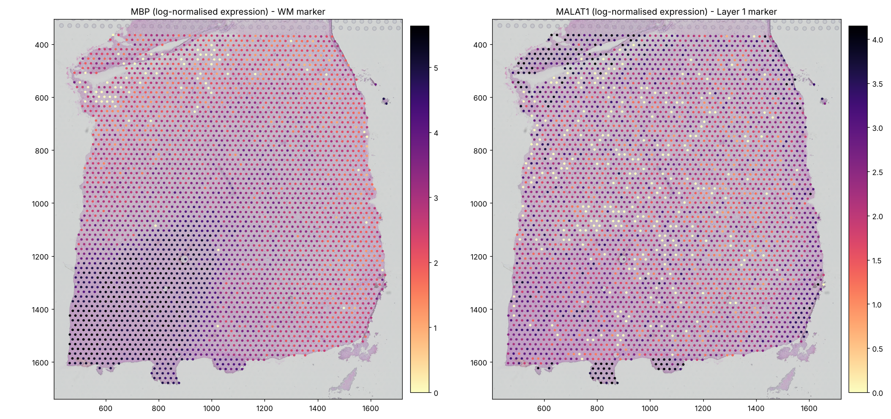
