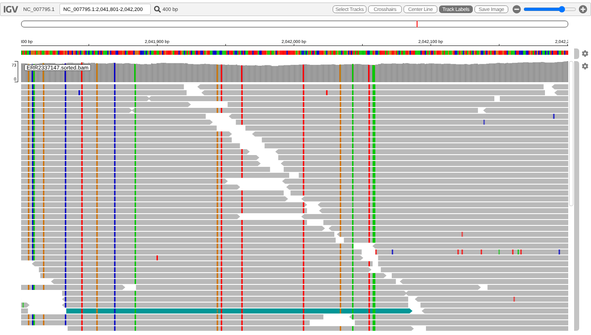

# COMP3353 Bioinformatics — Assignment 2: Sequence alignment and variant calling

Name: Zheng Choi I

University Number: 3035987788

Email: u3598778@connect.hku.hk

All my code is also in the `src/` folder. Each Python script takes its input
file path on the command line, e.g. `python3 src/q2_hamming.py data/Q2/input.fa`.

## Question 1: Run sequence alignment with bwa

The data are the paired-end reads of ERR2337147 (184,803 read pairs, 250 bp,
Illumina MiSeq) and the *S. aureus* NCTC 8325 reference genome
(NC_007795.1, 2,821,361 bp).

### 1(a) Alignment and visualisation

#### 1(a)(i) Commands

The commands I ran, following tutorial 2:

```bash
# install
conda install -c bioconda bwa samtools igv

# unzip and index the reference genome
gunzip -k data/Q1/ref.fna.gz
bwa index data/Q1/ref.fna
samtools faidx data/Q1/ref.fna

# align the two FASTQ files to the reference
bwa mem -t 4 data/Q1/ref.fna data/Q1/ERR2337147_1.fastq.gz data/Q1/ERR2337147_2.fastq.gz \
    | samtools view -bS - > results/q1/ERR2337147.bam

# sort and index the alignments
samtools sort results/q1/ERR2337147.bam -o results/q1/ERR2337147.sorted.bam
samtools index results/q1/ERR2337147.sorted.bam

# visualise the genome and the alignments
igv -g data/Q1/ref.fna results/q1/ERR2337147.sorted.bam
```

#### 1(a)(ii) igv screenshot and the region I picked

As a quick check I also ran `samtools flagstat`. 94.9% of the reads mapped,
and 93.5% were properly paired. The average depth over the genome is about 30×.

To find a region with good coverage I calculated the average depth in 1 kb
windows with `samtools depth -a` (the full command is in `src/run_q1.sh`). I
picked a window where the depth is high but every read maps with high
confidence, so the pile-up isn't inflated by repeats.

**Region shown: NC_007795.1:2,041,801-2,042,200.** Depth here is about 65–70×.
In the surrounding 2 kb (2,041,001-2,043,000), 577 of the 579 reads have MAPQ 60.



The coverage track is at the top and the piled-up reads are below it (grey
bars, with arrows showing the strand). Coloured marks are bases that differ
from the reference. Some columns are coloured in every single read. Those
can't be sequencing errors; they are real SNPs where this isolate differs from
the NCTC 8325 reference strain. The odd single coloured mark in one read is a
sequencing error.

(I made this screenshot with igv.js, the web version of IGV, loading the same
sorted BAM and reference.)

### 1(b) FLAG of the 10th record

#### 1(b)(i) The 10th record

```bash
samtools view results/q1/ERR2337147.sorted.bam | sed -n 10p
```

```
ERR2337147.11   163   NC_007795.1   1   60   97S153M   =   105   352   ...
```

#### 1(b)(ii) Decoding the FLAG

The FLAG is **163**. Written as a sum of bits, 163 = 128 + 32 + 2 + 1:

| Bit | Value | Meaning | In this read |
|---|---|---|---|
| 0x1 | 1 | read is paired | set: yes, it is paired |
| 0x2 | 2 | read mapped in a proper pair | set: yes |
| 0x4 | 4 | read is unmapped | not set: the read is mapped |
| 0x8 | 8 | mate is unmapped | not set: the mate is mapped |
| 0x10 | 16 | read is on the reverse strand | not set: forward strand |
| 0x20 | 32 | mate is on the reverse strand | set: the mate is on the reverse strand |
| 0x40 | 64 | first read in the pair | not set |
| 0x80 | 128 | second read in the pair | set |
| 0x100 | 256 | secondary alignment | not set |
| 0x200 | 512 | failed quality checks | not set |
| 0x400 | 1024 | PCR or optical duplicate | not set |
| 0x800 | 2048 | supplementary alignment | not set |

#### 1(b)(iii) Answer

This is the **second read** in the pair, and its **mate is mapped**. The
mate is on the reverse strand at position 105, and the fragment is 352 bp
long, which is a normal insert size for this library (bwa estimated
364 ± 80 bp).

I also noticed this read sits right at position 1 with the CIGAR `97S153M`:
its first 97 bases are clipped. The *S. aureus* chromosome is circular, so
those 97 bases actually come from the very end of the reference sequence.

### 1(c) Reads with MAPQ < 10

#### 1(c)(i) What I find in the CIGAR strings

```bash
samtools view -F 4 results/q1/ERR2337147.sorted.bam | awk '$5 < 10 {print $6}' | sort | uniq -c | sort -nr | head
```

```
    328 251M
    160 250M
     33 249M
     10 248M
      9 65M186H
      7 47M204H
      7 51M200H
      6 185H66M
      6 187H64M
      6 195H56M
      6 196H55M
      6 199H52M
      6 201H50M
      6 202H49M
      6 209H42M
```

There are 3,269 alignments with MAPQ < 10, under 1% of all mapped alignments.
Looking at their CIGAR strings, I found two kinds of reads:

1. **Most of them (2,602, about 80%) are clipped.** Their CIGARs contain `S`
   or `H`, e.g. `65M186H` or `8M3I25M1I14M3D69M131S`, so only part of the read lines up
   with the reference. Many of these reads are split across two places in
   the genome (they have an `SA` tag). A shorter aligned piece gets a lower
   score, which makes the aligner less sure of the position.
2. **The rest align perfectly along their full length** (`251M`, `250M`),
   yet still have low MAPQ. Almost all of them (574 of 585) have an `XA` tag
   listing another place in the genome where they fit just as well. These
   reads come from repeated sequences, such as the multiple rRNA operons, so
   bwa can't tell which copy they belong to. This shows that MAPQ is about how
   sure the aligner is of the *position*, not how good the match is.

#### 1(c)(ii) A representative read with MAPQ in [1, 5]

```
ERR2337147.5185   FLAG 185   NC_007795.1:36551   MAPQ 5   CIGAR 9S240M
NM:i:6   AS:i:210   XS:i:205   XA:Z:NC_007795.1,-42681,9S240M,7
```

The CIGAR `9S240M` means:

- `9S`: the first 9 bases are soft-clipped. They are still in the read
  sequence but are not aligned.
- `240M`: the next 240 bases are aligned to the reference starting at position
  36,551. `M` includes both matches and mismatches; `NM:i:6` says 6 of them
  are mismatches. There are no insertions or deletions.

The CIGAR itself looks fine, so the low MAPQ comes from somewhere else. The
`XA` tag shows the read also fits at position 42,681, about 6 kb away, with
exactly the same CIGAR and only one more mismatch (7 instead of 6). The
alignment scores are almost the same (AS = 210 vs XS = 205). The read could
come from either copy of this repeated sequence, so bwa gives it a MAPQ of
only 5. That corresponds to roughly a 30% chance that the position is wrong.
Its mate is unmapped (FLAG bit 0x8), so the pair can't help decide either.

## Question 2: Hamming distance

### 2(i) Source code

```python
import sys


def read_fasta(path):
    seqs = []
    seq = ""
    for line in open(path):
        line = line.strip()
        if line.startswith(">"):
            if seq:
                seqs.append(seq)
            seq = ""
        else:
            seq += line.upper()
    if seq:
        seqs.append(seq)
    return seqs


def hamming(s, t):
    if len(s) != len(t):
        raise ValueError("the two sequences must have the same length")
    count = 0
    for a, b in zip(s, t):
        if a != b:
            count += 1
    return count


s, t = read_fasta(sys.argv[1])[:2]
print(hamming(s, t))
```

`read_fasta` collects the sequence lines under each `>` header into one string.
`hamming` walks along both sequences together and counts the positions where
the letters differ.

### 2(ii) Output on `data/Q2/input.fa`

```
$ python3 src/q2_hamming.py data/Q2/input.fa
79
```

The Hamming distance is **79**. Both sequences are 500 bp.

## Question 3: Edit distance

### 3(i) Source code

```python
import sys


def read_fasta(path):
    seqs = []
    seq = ""
    for line in open(path):
        line = line.strip()
        if line.startswith(">"):
            if seq:
                seqs.append(seq)
            seq = ""
        else:
            seq += line.upper()
    if seq:
        seqs.append(seq)
    return seqs


def edit_distance(s, t):
    n, m = len(s), len(t)
    # D[i][j] = edit distance between the first i bases of s and the first j bases of t
    D = [[0] * (m + 1) for _ in range(n + 1)]
    for i in range(n + 1):
        D[i][0] = i
    for j in range(m + 1):
        D[0][j] = j
    for i in range(1, n + 1):
        for j in range(1, m + 1):
            mismatch = 0 if s[i - 1] == t[j - 1] else 1
            D[i][j] = min(D[i - 1][j] + 1,             # deletion
                          D[i][j - 1] + 1,             # insertion
                          D[i - 1][j - 1] + mismatch)  # match / substitution
    return D[n][m]


if __name__ == "__main__":
    s, t = read_fasta(sys.argv[1])[:2]
    print(edit_distance(s, t))
```

### 3(ii) How I populate the distance matrix

I make a matrix `D` with `len(s) + 1` rows and `len(t) + 1` columns.
`D[i][j]` is the edit distance between the first `i` letters of `s` and the
first `j` letters of `t`.

1. **First row and column.** `D[0][0] = 0`. `D[i][0] = i`, because turning `i`
   letters into an empty string takes `i` deletions. `D[0][j] = j`, because
   building `j` letters from nothing takes `j` insertions.
2. **The other cells.** I fill the matrix row by row, left to right. Each cell
   only needs the cell above it, the cell to its left, and the cell diagonally
   up-left, and those are always filled already. The last step of turning
   `s[:i]` into `t[:j]` has to be one of three things:
   - delete `s[i]`: cost `D[i-1][j] + 1`
   - insert `t[j]`: cost `D[i][j-1] + 1`
   - line up `s[i]` with `t[j]`: cost `D[i-1][j-1]`, plus 1 if the letters
     are different (a substitution)

   I take the smallest of the three.
3. **The answer** is the bottom-right cell, `D[len(s)][len(t)]`.

### 3(iii) Output on `data/Q2/input.fa`, compared with Question 2

```
$ python3 src/q3_edit_distance.py data/Q2/input.fa
7
```

The edit distance is **7**, much smaller than the Hamming distance of **79**.
To see why, I lined the two sequences up and found these 7 edits (positions
in the first sequence):

| Position | Edit | Cost |
|---|---|---|
| 159 | C changed to G | 1 |
| after 200 | `GC` inserted | 2 |
| 301–302 | `AA` deleted | 2 |
| 435 | C changed to A | 1 |
| 440 | A changed to G | 1 |
| | **Total** | **7** |

The insertion after position 200 pushes everything after it two places to
the right, and the deletion at 301–302 pushes it back. Hamming distance can
only compare position 1 with position 1, position 2 with position 2, and so
on, so it sees that whole shifted stretch of about 100 bases as mismatches:
76 of them, plus the 3 real substitutions, gives 79. Edit distance can
insert and delete, so it charges only 2 + 2 for the shift. In general the
edit distance can never be bigger than the Hamming distance, because
substitutions alone are one possible way to edit one sequence into the other.

### 3(iv) Output on `data/Q3/input.fa`

```
$ python3 src/q3_edit_distance.py data/Q3/input.fa
1704
```

The edit distance is **1704**. The file holds two hepatitis B virus genomes:
X02763.1 (3,221 bp) and NC_003977.2 (3,182 bp).

1704 seemed too high for two strains of the same virus, so I looked closer.
The HBV genome is circular, and the two records start at different points
on the circle: the start of X02763.1 appears at position 1,815 of
NC_003977.2. When I rotated NC_003977.2 so both start at the same base, the
edit distance dropped to **335**, about 10% of the genome, which is more
like what I'd expect between two strains.

## Question 4: BWT encoder and decoder

### 4(a) The BWT encoder

#### 4(a)(i) Source code

Both the encoder and the decoder are in `src/bwt.py`. This is the encoder part:

```python
import sys


def read_fasta(path):
    seq = ""
    for line in open(path):
        if not line.startswith(">"):
            seq += line.strip().upper()
    return seq


def suffix_array(text):
    # Sort suffix start positions by "prefix doubling": first by their first
    # letter, then by their first 2, 4, 8, ... letters, reusing the ranks from
    # the previous round. This never copies the suffixes themselves, so it
    # also works for a whole genome.
    n = len(text)
    rank = [ord(c) for c in text]
    order = list(range(n))
    k = 1
    while True:
        key = lambda i: (rank[i], rank[i + k] if i + k < n else -1)
        order.sort(key=key)
        new_rank = [0] * n
        for a, b in zip(order, order[1:]):
            new_rank[b] = new_rank[a] + (1 if key(a) != key(b) else 0)
        rank = new_rank
        if rank[order[-1]] == n - 1:  # every suffix has its own rank: done
            return order
        k *= 2


def bwt_encode(seq):
    text = seq + "$"
    # Sorting all rotations of text is the same as sorting its suffixes,
    # because "$" is unique and smaller than A/C/G/T.
    order = suffix_array(text)
    # the last letter of the rotation starting at i is text[i - 1]
    return "".join(text[i - 1] for i in order)
```

To encode, I add `$` to the end of the sequence, sort all its rotations, and
take the last letter of each rotation. Sorting the rotations is the same as
sorting the suffixes, so `suffix_array` sorts the suffix start positions
instead of building every rotation. That keeps memory low for the 30 kb genome.

#### 4(a)(ii) Output on `data/Q4/input1.fa`

```
$ python3 src/bwt.py encode data/Q4/input1.fa
TC$GAATCCGG
```

To check it by hand, here are the sorted rotations of `ACGTGCACGT$`. Reading
the last column from top to bottom gives `TC$GAATCCGG`.

| Row | Rotation | Last letter |
|---|---|---|
| 0 | `$ACGTGCACGT` | T |
| 1 | `ACGT$ACGTGC` | C |
| 2 | `ACGTGCACGT$` | $ |
| 3 | `CACGT$ACGTG` | G |
| 4 | `CGT$ACGTGCA` | A |
| 5 | `CGTGCACGT$A` | A |
| 6 | `GCACGT$ACGT` | T |
| 7 | `GT$ACGTGCAC` | C |
| 8 | `GTGCACGT$AC` | C |
| 9 | `T$ACGTGCACG` | G |
| 10 | `TGCACGT$ACG` | G |

#### 4(a)(iii) Output on `data/Q4/input2.fa` (first 50 symbols), and what I find

```
$ python3 src/bwt.py encode data/Q4/input2.fa | cut -c1-50
AAAAAAAAAAAAAAAAAAAAAAAAAAAAAAAAACTGTCTTCTTTCCTTGG
```

**What I find:** input2 is the SARS-CoV-2 genome, and its BWT starts with
33 A's in a row. That's because the genome ends with a poly-A tail of 33 A's.
After the `$` row, the next rotations in sorted order are `A$…`, `AA$…`,
`AAA$…` and so on, all starting inside that tail. Each of them is preceded by
another A, so their last letters are all A. The run stops at the rotation
that starts with the whole tail, which is preceded by a C.

This is the key property of the BWT. Rotations that start with the same
letters end up next to each other, and they are often preceded by the same
letter too. So the BWT groups identical letters into runs. That is why it
compresses well, and why it is useful for searching.

### 4(b) The BWT decoder

#### 4(b)(i) Source code

The decoder part of `src/bwt.py` (it uses `read_fasta` and `bwt_encode` from 4(a)(i) when run as a script):

```python
def bwt_decode(bwt):
    # first column F = sorted(bwt); first[c] = row where c first appears in F
    first = {}
    for row, c in enumerate(sorted(bwt)):
        if c not in first:
            first[c] = row
    # LF mapping: the k-th c in the last column is the k-th c in the first column
    seen = {}
    lf = []
    for c in bwt:
        lf.append(first[c] + seen.get(c, 0))
        seen[c] = seen.get(c, 0) + 1
    # row 0 starts with "$", so bwt[0] is the last base of the sequence;
    # following LF walks the sequence backwards
    seq = ""
    row = 0
    for _ in range(len(bwt) - 1):
        seq = bwt[row] + seq
        row = lf[row]
    return seq


if __name__ == "__main__":
    mode, path = sys.argv[1], sys.argv[2]
    if mode == "encode":
        print(bwt_encode(read_fasta(path)))
    else:
        print(bwt_decode(open(path).read().strip()))
```

To decode, I use the LF mapping. The first column of the sorted rotations is
just the BWT sorted, and the k-th `A` in the last column is the same `A` in
the text as the k-th `A` in the first column (the same holds for every
letter). Row 0 starts with `$`, so its last letter is the final base of the
sequence. From there, following the LF mapping steps backwards through the
sequence one base at a time.

#### 4(b)(ii) Output on `data/Q4/input3.txt`

```
$ python3 src/bwt.py decode data/Q4/input3.txt
AGTTGTTGATCTGTGTGAGTCAGACTGCGACAGTTCGAGTCTGAAGCGAGA
```

#### 4(b)(iii) Output on the BWT string from `data/Q4/input1.fa`

```
$ python3 src/bwt.py encode data/Q4/input1.fa > input1.bwt.txt
$ python3 src/bwt.py decode input1.bwt.txt
ACGTGCACGT
```

**Yes, it is the same as the original sequence** (`ACGTGCACGT`). The BWT is
fully reversible because the `$` marks where the sequence ends. As an extra
check, I encoded the decoded input3 sequence again and got back exactly the
input3 string.

## Question 5: Search with BWT

I chose to write code, reusing `read_fasta` and `bwt_encode` from Question 4.

### 5(i) Source code

```python
import sys

from bwt import read_fasta, bwt_encode  # reused from Question 4


def build_fm_index(bwt):
    alphabet = sorted(set(bwt))
    # C[c] = number of symbols smaller than c
    C = {}
    total = 0
    for c in alphabet:
        C[c] = total
        total += bwt.count(c)
    # Occ[c][k] = number of c in the first k symbols of the BWT
    Occ = {c: [0] for c in alphabet}
    for ch in bwt:
        for c in alphabet:
            Occ[c].append(Occ[c][-1] + (1 if ch == c else 0))
    return C, Occ


def backward_search(motif, C, Occ, n):
    lo, hi = 0, n
    for c in reversed(motif):
        lo = C[c] + Occ[c][lo]
        hi = C[c] + Occ[c][hi]
        print(f"  {c}: [{lo}, {hi})")
        if lo >= hi:
            return 0
    return hi - lo


path, motif = sys.argv[1], sys.argv[2]
bwt = bwt_encode(read_fasta(path))
n = len(bwt)
C, Occ = build_fm_index(bwt)
alphabet = sorted(C)

print("BWT:", bwt if n <= 100 else bwt[:100] + "...")
print("C:", ", ".join(f"C[{c}]={C[c]}" for c in alphabet))
print("Occ:")
print("   k  " + "  ".join(f"{c:>5}" for c in alphabet))
rows = list(range(n + 1)) if n <= 20 else list(range(6)) + [n]
for k in rows:
    if k == n and n > 20:
        print("  ...")
    print(f"{k:>5} " + "  ".join(f"{Occ[c][k]:>5}" for c in alphabet))
print(f"Backward search for {motif}:")
print("Occurrences:", backward_search(motif, C, Occ, n))
```

How it works:

- `C[c]` counts how many letters in the text are smaller than `c`
  (`$ < A < C < G < T`). It is the row where the rotations starting with `c`
  begin.
- `Occ[c][k]` counts how many times `c` appears in the first `k` letters of
  the BWT.
- **Backward search** starts with all rows, `[0, n)`, and reads the motif from
  its *last* letter to its first. For each letter `c` it updates the range to
  `lo = C[c] + Occ[c][lo]` and `hi = C[c] + Occ[c][hi]`. After each step, the
  range holds exactly the rotations that start with the part of the motif read
  so far. At the end, the number of matches is `hi − lo`.

### 5(ii) Output on {path: `data/Q4/input1.fa`, s: "ACGT"}

```
BWT: TC$GAATCCGG
C: C[$]=0, C[A]=1, C[C]=3, C[G]=6, C[T]=9
Occ:
   k      $      A      C      G      T
    0     0      0      0      0      0
    1     0      0      0      0      1
    2     0      0      1      0      1
    3     1      0      1      0      1
    4     1      0      1      1      1
    5     1      1      1      1      1
    6     1      2      1      1      1
    7     1      2      1      1      2
    8     1      2      2      1      2
    9     1      2      3      1      2
   10     1      2      3      2      2
   11     1      2      3      3      2
Backward search for ACGT:
  T: [9, 11)
  G: [7, 9)
  C: [4, 6)
  A: [1, 3)
Occurrences: 2
```

Step by step, using the C and Occ tables above:

| Letter | lo | hi | Rows that start with |
|---|---|---|---|
| start | 0 | 11 | anything |
| T | C[T] + Occ[T][0] = 9 + 0 = **9** | C[T] + Occ[T][11] = 9 + 2 = **11** | `T` |
| G | C[G] + Occ[G][9] = 6 + 1 = **7** | C[G] + Occ[G][11] = 6 + 3 = **9** | `GT` |
| C | C[C] + Occ[C][7] = 3 + 1 = **4** | C[C] + Occ[C][9] = 3 + 3 = **6** | `CGT` |
| A | C[A] + Occ[A][4] = 1 + 0 = **1** | C[A] + Occ[A][6] = 1 + 2 = **3** | `ACGT` |

**ACGT occurs 3 − 1 = 2 times.** Rows 1 and 2 in the rotation table of 4(a)
are the two matches, at positions 1 and 7 of `ACGTGCACGT`.

### 5(iii) Output on {path: `data/Q4/input2.fa`, s: "ACGT"}

```
BWT: AAAAAAAAAAAAAAAAAAAAAAAAAAAAAAAAACTGTCTTCTTTCCTTGGTTCCTCCCTGGTTGTTGACTTTTCTTGTTTCTGGATTCCTGAAGTCTGGC...
C: C[$]=0, C[A]=1, C[C]=8955, C[G]=14447, C[T]=20310
Occ:
   k      $      A      C      G      T
    0     0      0      0      0      0
    1     0      1      0      0      0
    2     0      2      0      0      0
    3     0      3      0      0      0
    4     0      4      0      0      0
    5     0      5      0      0      0
  ...
29904     1   8954   5492   5863   9594
Backward search for ACGT:
  T: [20310, 29904)
  G: [18320, 20310)
  C: [12195, 12366)
  A: [4167, 4231)
Occurrences: 64
```

(The BWT and Occ table for this 29,903 bp genome are too long to print in
full, so the script shows only their beginning and the last row.)

**ACGT occurs 64 times** in the SARS-CoV-2 genome. I checked this by counting
ACGT directly in the sequence, which also gives 64.

## Question 6: Variant calling

I chose to write code. The same script answers all three parts.

### 6(i) Source code

```python
from scipy.stats import binom

ERROR = 0.01


def mutant_probability(n_T, n, prior_AT, prior_TT):
    prior = {"AA": 1 - prior_AT - prior_TT, "AT": prior_AT, "TT": prior_TT}
    # chance that one read shows T under each genotype
    p_T = {"AA": ERROR, "AT": 0.5, "TT": 1 - ERROR}
    joint = {g: binom.pmf(n_T, n, p_T[g]) * prior[g] for g in prior}
    total = sum(joint.values())
    for g in prior:
        print(f"  P({g} | data) = {joint[g] / total:.4g}")
    return (joint["AT"] + joint["TT"]) / total


print("(a)")
print("  P(mutant) =", round(mutant_probability(1, 5, 0.02, 0.001), 4))
print("(b)")
print("  P(mutant) =", round(mutant_probability(6, 30, 0.02, 0.001), 4))
print("(c)")
print("  P(mutant) =", round(mutant_probability(6, 30, 0.0005, 0.00001), 4))
```

### 6(ii) How I set up the calculation

The reference base is A and some reads show T. For each genotype I first need
the chance that a single read shows T:

- **AA:** a T can only come from a sequencing error, so P(T) = 0.01.
- **AT:** half the reads come from each copy, so
  P(T) = 0.5 × 0.99 + 0.5 × 0.01 = 0.5.
- **TT:** every read should be T unless there's an error, so P(T) = 0.99.

The reads are independent, so the chance of seeing k T's out of n reads is
binomial: `binom.pmf(k, n, P(T))`. Bayes' theorem then gives:

P(genotype | reads) = P(reads | genotype) × P(genotype) / P(reads)

where P(reads) is the sum of P(reads | genotype) × P(genotype) over all three
genotypes. The patient is a mutant if the genotype is AT or TT.

### 6(iii) Output

```
(a)
  P(AA | data) = 0.9377
  P(AT | data) = 0.06232
  P(TT | data) = 9.871e-10
  P(mutant) = 0.0623
(b)
  P(AA | data) = 0.03966
  P(AT | data) = 0.9603
  P(TT | data) = 4.854e-41
  P(mutant) = 0.9603
(c)
  P(AA | data) = 0.6278
  P(AT | data) = 0.3722
  P(TT | data) = 7.526e-42
  P(mutant) = 0.3722
```

### 6(a) 4 A's and 1 T out of 5 reads

Priors: AT = 0.02, TT = 0.001, so AA = 1 − 0.02 − 0.001 = 0.979.

| Genotype | P(reads \| genotype) | × prior | P(genotype \| reads) |
|---|---|---|---|
| AA | 5 × 0.01 × 0.99⁴ = 0.04803 | × 0.979 = 0.04702 | 0.9377 |
| AT | 5 × 0.5⁵ = 0.15625 | × 0.02 = 0.003125 | 0.0623 |
| TT | 5 × 0.99 × 0.01⁴ = 4.95 × 10⁻⁸ | × 0.001 = 4.95 × 10⁻¹¹ | ≈ 0 |
| **Sum** | | **0.05015** | |

**The chance that the patient is a mutant is about 6.2%** (almost all of it
heterozygous AT). One T in five reads fits AT about three times better than
AA, but AA is about 49 times more common to begin with. So the single T is
most likely just a sequencing error.

### 6(b) 24 A's and 6 T's out of 30 reads

Same priors as (a).

| Genotype | P(reads \| genotype) | × prior | P(genotype \| reads) |
|---|---|---|---|
| AA | C(30,6) × 0.01⁶ × 0.99²⁴ = 4.665 × 10⁻⁷ | 4.567 × 10⁻⁷ | 0.0397 |
| AT | C(30,6) × 0.5³⁰ = 5.530 × 10⁻⁴ | 1.106 × 10⁻⁵ | 0.9603 |
| TT | C(30,6) × 0.99⁶ × 0.01²⁴ ≈ 5.6 × 10⁻⁴³ | ≈ 0 | ≈ 0 |

**The chance that the patient is a mutant is now about 96%**, again almost
all heterozygous. With 30 reads and a 1% error rate, we'd only expect about
0.3 wrong T's, so seeing 6 is very unlikely to be just errors. The data now
favour AT over AA by about 1,185 to 1, which easily beats the 49 to 1 prior.

### 6(c) Same reads, but at a site where mutations are rare

Priors: AT = 0.0005, TT = 0.00001, so AA = 0.99949.

| Genotype | P(reads \| genotype) | × prior | P(genotype \| reads) |
|---|---|---|---|
| AA | 4.665 × 10⁻⁷ | 4.663 × 10⁻⁷ | 0.6278 |
| AT | 5.530 × 10⁻⁴ | 2.765 × 10⁻⁷ | 0.3722 |
| TT | ≈ 5.6 × 10⁻⁴³ | ≈ 0 | ≈ 0 |

**The chance that the patient is a mutant drops to about 37%.** The reads are
exactly the same as in (b), but at this site AA is about 2,000 times more
common than AT to begin with. That is more than the 1,185 to 1 the reads
give in favour of AT, so AA (errors only) is now slightly more likely. This
shows how much the prior matters for rare variants: the same reads can mean
a confident call at one site and an uncertain one at another. To be sure
here, we would need more reads.
