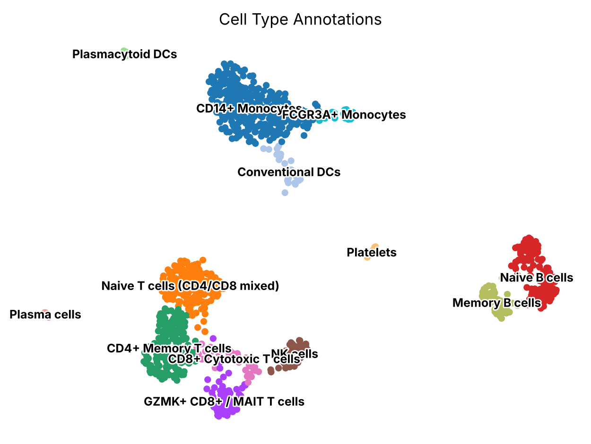

# COMP3353 Lab 4 — Question 8


**Code**
```python
marker_genes = {
    "CD4+ T cells": ["CD3D", "IL7R", "TCF7"],
    "CD8+ T cells": ["CD3D", "GZMA", "GZMK", "CD8A"],
    "NK cells": ["NKG7", "GNLY", "PRF1", "KLRD1"],
    "B cells": ["MS4A1", "CD79A", "CD79B"],
    "Monocytes": ["CD14", "S100A9", "LYZ"],
    "FCGR3A+ Mono": ["FCGR3A", "MS4A7"],
    "Dendritic cells": ["HLA-DRA", "HLA-DPA1", "CST3"],
    "pDC": ["LILRA4", "IL3RA"],
    "Platelets": ["PPBP", "TUBB1", "CAVIN2"],
}

sc.pl.dotplot(
    filtered_adata,
    var_names=marker_genes,
    groupby="leiden_clusters",
    standard_scale="var",
)

sc.pl.umap(
    filtered_adata,
    color=["CD3D", "MS4A1", "CD14", "NKG7", "PPBP", "HLA-DPA1"],
    ncols=3,
    frameon=False,
    layer="log",
)

# Top DEGs per cluster
for g, df in markers_filtered.groupby("group", observed=True):
    top = df[(df["pvals_adj"] < 0.05) & (df["logfoldchanges"] > 0)].head(8)
    print(f"cluster {g}: {', '.join(top['names'])}")

cluster_labels = {
    "0": "CD14+ Monocytes",
    "1": "Naive T cells (CD4/CD8 mixed)",
    "2": "CD4+ Memory T cells",
    "3": "Naive B cells",
    "4": "GZMK+ CD8+ / MAIT T cells",
    "5": "NK cells",
    "6": "CD8+ Cytotoxic T cells",
    "7": "Memory B cells",
    "8": "FCGR3A+ Monocytes",
    "9": "Conventional DCs",
    "10": "Platelets",
    "11": "Plasmacytoid DCs",
    "12": "Plasma cells",
}

filtered_adata.obs["cell_type"] = (
    filtered_adata.obs["leiden_clusters"].map(cluster_labels).astype("category")
)

sc.pl.umap(
    filtered_adata,
    color="cell_type",
    legend_loc="on data",
    legend_fontsize=9,
    legend_fontoutline=2,
    frameon=False,
    title="Cell Type Annotations",
)
```

**Result (top DEGs per cluster)**
```
cluster 0: S100A8, S100A9, FOS, LYZ, VCAN, CTSS, DUSP1, FCN1
cluster 1: TPT1, EEF1A1, LDHB, EEF1B2, TCF7, NPM1, SARAF, PIK3IP1
cluster 2: LDHB, TRAC, IL7R, IL32, LTB, CD3E, CD3D, CD2
cluster 3: IGHD, CD37, IGHM, CD79A, MS4A1, CD79B, CD74, LINC00926
cluster 4: GZMK, KLRB1, KLRG1, GZMA, NKG7, CTSW, IL32, CCL5
cluster 5: KLRD1, GNLY, NKG7, CTSW, KLRF1, CD7, GZMA, PRF1
cluster 6: CCL5, GZMM, NKG7, B2M, CTSW, IL32, CD8A, GZMA
cluster 7: BANK1, MS4A1, IGKC, CD79A, HLA-DQA1, CD79B, CD37, HLA-DPB1
cluster 8: LST1, AIF1, FCGR3A, COTL1, SMIM25, MS4A7, HES4, SAT1
cluster 9: CST3, HLA-DRB1, HLA-DRB5, CD74, HLA-DPA1, HLA-DPB1, HLA-DRA, S100A10
cluster 10: PPBP, TAGLN2, PF4, HIST1H2AC, PGRMC1, NRGN, CDKN2D, OAZ1
cluster 11: LILRA4, IL3RA, PPP1R14B, TCF4, SERPINF1, UGCG, IRF7, SMPD3
cluster 12: IGKC, SUB1, JCHAIN, TNFRSF17, MZB1, PPIB, ITM2C, SSR4
```
Plot: `results/q8_celltype_umap.png`



**Answer — cluster-to-cell-type mapping**
| Cluster | Cell type | Evidence | # cells |
|---|---|---|---|
| 0 | CD14+ Monocytes | S100A8/9, LYZ, VCAN, FCN1, CD14 | 320 |
| 1 | Naive T cells (CD4/CD8 mixed) | CD3D, CCR7, TCF7, LDHB; some CD8A/B | 179 |
| 2 | CD4+ Memory T cells | CD3D/E, IL7R, IL32, LTB; no CD8 | 177 |
| 3 | Naive B cells | IGHD, IGHM, TCL1A, MS4A1, CD79A | 133 |
| 4 | GZMK+ CD8+ / MAIT T cells | CD3D, GZMK, KLRB1, KLRG1, CCL5 | 79 |
| 5 | NK cells | GNLY, NKG7, KLRD1, KLRF1, PRF1; no CD3D | 56 |
| 6 | CD8+ Cytotoxic T cells | CD3D, CD8A/B, CCL5, GZMM, GZMA | 52 |
| 7 | Memory B cells | MS4A1, CD79A, BANK1, IGKC; low IGHD/TCL1A | 49 |
| 8 | FCGR3A+ Monocytes | FCGR3A (CD16), MS4A7, LST1, AIF1 | 28 |
| 9 | Conventional DCs | FCER1A, CST3, very high HLA class II | 28 |
| 10 | Platelets | PPBP, PF4, TUBB1, CAVIN2 | 13 |
| 11 | Plasmacytoid DCs | LILRA4, IL3RA, TCF4, IRF7 | 8 |
| 12 | Plasma cells | JCHAIN, MZB1, TNFRSF17, IGKC | 8 |

**Which clusters were challenging, and why**
- **Cluster 1:** most of its top DEGs are housekeeping or translation genes (TPT1, EEF1A1, EEF1B2, NPM1) plus naive/quiescence markers (CCR7, TCF7, LDHB). These show the cells are naive T cells, but they don't separate CD4 from CD8. CD8A/CD8B are expressed at an intermediate level, so the cluster probably mixes naive CD4 and naive CD8 T cells. I gave it the broader label "Naive T cells (CD4/CD8 mixed)".
- **Cluster 4:** it expresses CD3D, GZMK, KLRB1 (CD161), KLRG1 and IL7R. This pattern fits both GZMK⁺ CD8 effector-memory T cells and MAIT cells. Telling them apart would need extra markers (e.g. TRAV1-2, SLC4A10) or TCR data, so I used a combined label.
- **Clusters 5 and 6 (NK vs CD8 cytotoxic T cells):** both share cytotoxic genes (NKG7, GZMA, PRF1, CCL5). I separated them using CD3D/CD8A, which are present in cluster 6 and absent in cluster 5, and GNLY/KLRF1, which are much higher in cluster 5.
- **Small clusters 9–12:** these have only 8–28 cells each, so their DE statistics are weaker. Even so, each has very specific markers (FCER1A, LILRA4, JCHAIN/MZB1, PPBP). The cDC cluster also shows some monocyte genes (LYZ, S100A9), probably because cDCs and monocytes share myeloid genes, or because a few doublets are present.
